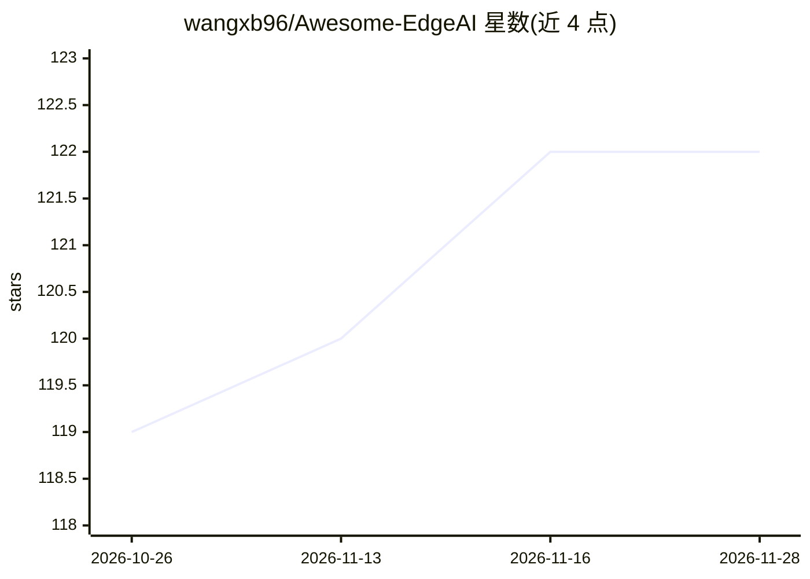

# wangxb96/Awesome-EdgeAI

⭐ 122 · Python · NOASSERTION · 推送 2026-11-18 · [GitHub](https://github.com/wangxb96/Awesome-EdgeAI) · 组织维护

**边缘 AI 综述论文配套的资源清单与部署决策指南**

该仓库是两篇边缘计算综述论文（arXiv:2501.03265 v1/v2）的配套资源集合，按数据—模型—系统优化框架整理紧凑语言/多模态模型、函数调用 agent 与端侧推理运行时的文献与工具清单。内容按部署决策流程组织：定义任务验收、测量瓶颈、选择控制手段、验证完整执行周期；覆盖模型选型表、生成推理栈对照表、MCU 推理、量化/解码/调度等优化文献条目。面向需要在资源受限设备上部署大模型与 agent 的研究者与工程师。

## 筛选速览

| 维度 | 判定 | 备注 |
|---|---|---|
| AI 角色 | `ai-knowledge` | 知识聚合/清单类 |
| 许可风险 | `none` | NOASSERTION |
| 部署形态 | `None` |  |
| 模型依赖 | — | README 未给出锁定关系 |
| 硬件要求 | — | 无带数字的原话,不猜 |
| 安装摩擦 | `low` | 无编译、无系统依赖或容器化 |
| 成熟度 | — | 结构信号不足 |

## 能力要点

- 配套 arXiv:2501.03265 v1/v2 两版综述论文的资源集合
- 提供角色匹配的模型工件表与生成推理栈对照表（含核对要点）
- 按部署决策流程组织：验收定义→瓶颈测量→控制选择→完整验证
- 覆盖量化、投机解码、KV 缓存、边缘调度等方向的论文条目

## 适用场景

- 查找端侧 LLM 与多模态模型的压缩、加速与部署文献
- 为边缘设备选型推理运行时并核对其兼容性要点
- 撰写边缘 AI 相关综述时用作文献地图

## 场景标签

`精选清单` · 领域:学习与行业

## 证据(README 行号)

> L17: The current public preprint is Cognitive Edge Computing: A Comprehensive Survey on Optimizing Large Models and AI A
> L7: **From data–model–system optimization to cognitive edge computing.** A curated guide to compact language and multimo
> L21: |**v1 · 4 January 2025**|**Xubin Wang and Weijia Jia.** Optimizing Edge AI: A Comprehensive Survey on Data, Model, 

## 星数曲线

2026-10-26 119 → 2026-11-28 122（+3）

---
*卡片 v1 · prompt 1.4 · 生成 2026-11-28 · 置信度 high · 依据 README sha `888141e2bbf8` · [字段定义](../../DATASET.md)*
