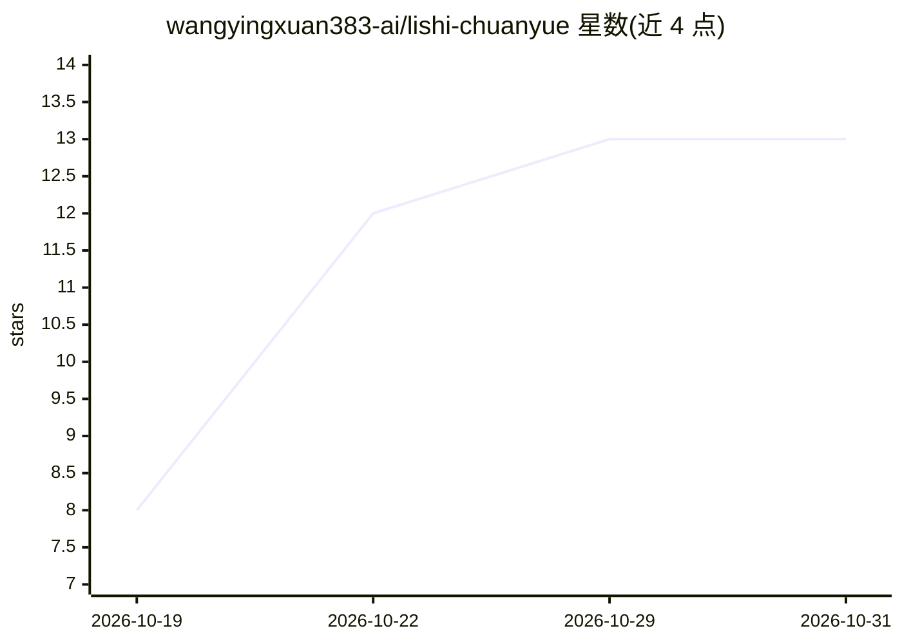

# wangyingxuan383-ai/lishi-chuanyue

⭐ 13 · TypeScript · 推送 2026-10-19 · [GitHub](https://github.com/wangyingxuan383-ai/lishi-chuanyue) · [官网](https://github.com/wangyingxuan383-ai/lishi-chuanyue/releases) · 个人维护 · 中文 README

**装在手机和电脑里的历史穿越 AI 互动小说应用**

面向消费者的 AI 互动小说应用：用户写开头、扮演主角，用一句话决定行动，由接入的 AI 服务续写故事。支持历史穿越（年号纪年、物价称谓随时代）与自由世界，提供自由、剧本、挑战、旁观四种玩法；程序负责记账钱物、人物态度、章节摘要与回合树。可导入 TXT/EPUB/PDF/DOCX 作为世界资料或同人起点。应用本身不带 AI，需用户自备 OpenAI 兼容服务与 Key；目前为个人开发的预发布阶段，安卓 7.0+/Windows 10/11 可用，暂未授予开源许可。

## 筛选速览

| 维度 | 判定 | 备注 |
|---|---|---|
| AI 角色 | `ai-native` | 本体是模型或模型工具 |
| 许可风险 | `none` | — |
| 部署形态 | `desktop` | 安装包/桌面程序 |
| 模型依赖 | — | README 未给出锁定关系 |
| 硬件要求 | — | 无带数字的原话,不猜 |
| 安装摩擦 | `low` | 无编译、无系统依赖或容器化 |
| 成熟度 | `idea` | |

## 能力要点

- 四种玩法：自由、剧本、挑战、旁观，AI 按幕推进
- 程序记账钱物、人物态度与章节摘要，支持回合树回头重走
- 导入 TXT/EPUB/PDF/DOCX 作世界资料或从原著章节开始同人
- 接用户自备的 OpenAI 兼容服务，内置多家国内服务商预设

## 适用场景

- 在手机上玩历史穿越或自由世界的 AI 互动小说
- 导入自己喜欢的原著做同人故事
- 用旁观模式看 AI 演主角，自己幕后指点

## 场景标签

`AI 写作` · 领域:内容生成

## 证据(README 行号)

> L3: **装在手机里的 AI 互动小说：写下开头，成为主角，用一句话决定接下来做什么，AI 把故事接着写下去。**
> L59: 应用本身不带 AI，需要你自己的服务和 Key：兼容 OpenAI 接口的服务都可以。内置了 DeepSeek、硅基流动、智谱、通义千问、Kimi、火山方舟、OpenRouter 和 Gemini 的预设，每家都附了“申请 Key

## 星数曲线

2026-10-19 8 → 2026-10-31 13（+5）

---
*卡片 v1 · prompt 1.4 · 生成 2026-10-31 · 置信度 high · 依据 README sha `186f41db77b5` · [字段定义](../../DATASET.md)*
