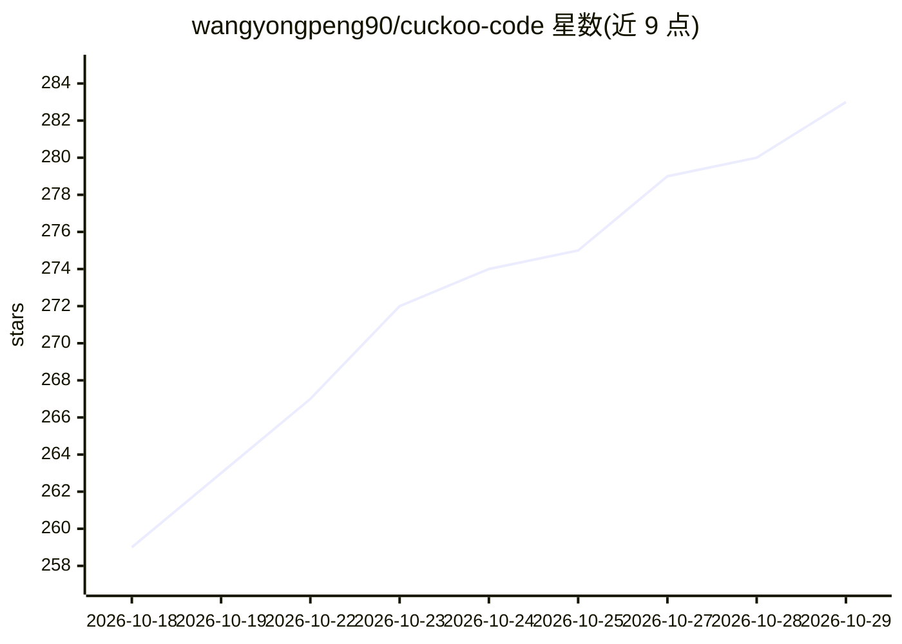

# wangyongpeng90/cuckoo-code

⭐ 283 · TypeScript · NOASSERTION · 推送 2026-10-28 · [GitHub](https://github.com/wangyongpeng90/cuckoo-code) · 个人维护 · 中文 README

**零 Token 成本的 AI Agent 桌面端：网页版账号驱动本地工具执行**

基于 Electron 的桌面应用，将 DeepSeek 等 AI 网页版嵌入本地窗口并注入覆盖层：AI 被系统提示词引导生成 cuckoo 代码块形式的工具调用，经用户确认后本地沙箱执行（读写文件、执行命令、查库、调用 MCP），结果回传形成 Agent 循环，全程不使用 API Key。面向用网页版账号做编程/项目操作的开发者，内置 Provider 框架可导入自定义平台，并支持 Skill/子代理/Rules 等机制。从源码构建运行，CI 产出 Windows/macOS 安装包。

## 筛选速览

| 维度 | 判定 | 备注 |
|---|---|---|
| AI 角色 | `ai-native` | 本体是模型或模型工具 |
| 许可风险 | `none` | NOASSERTION |
| 部署形态 | `None` |  |
| 模型依赖 | locked-api |  |
| 硬件要求 | — | 无带数字的原话,不猜 |
| 安装摩擦 | `low` | 无编译、无系统依赖或容器化 |
| 成熟度 | — | 结构信号不足 |

## 能力要点

- 网页版 AI 账号 + 本地沙箱工具执行，无需 API Key
- Provider 框架支持多平台与自定义导入
- 对齐 Claude Code 的 Skill / 子代理 / Rules 机制
- MCP 支持（Claude Desktop 兼容格式，stdio/http）

## 适用场景

- 用网页版 AI 账号让 Agent 直接改代码、跑命令、查数据库
- 通过 MCP 与 Skill 扩展 AI 的领域操作能力
- 多窗口管理多个 AI 平台账号的 Agent 会话

## 场景标签

`编码 Agent` · 领域:编码与开发

## 证据(README 行号)

> L17: **Cuckoo Code** 是一个零 Token 成本的 AI Agent 桌面端。
> L21: 它通过 Electron 将 AI 网页版嵌入本地窗口，并注入侧边覆盖层。AI 被系统提示词引导生成工具调用（JavaScript 代码块），经用户确认后在本地沙箱中执行，再把结果回传给 AI。整个过程不需要 API Key，你用
> L37: 不只是聊天。AI 可以读写文件、搜索代码、执行命令、查询数据库、调用 MCP 工具，并依据执行结果继续下一步，形成"思考 → 行动 → 观察 → 再行动"的 Agent 循环。

## 星数曲线

2026-10-18 259 → 2026-10-29 283（+24）

---
*卡片 v1 · prompt 1.4 · 生成 2026-10-22 · 置信度 high · 依据 README sha `e4d593f03a61` · [字段定义](../../DATASET.md)*
