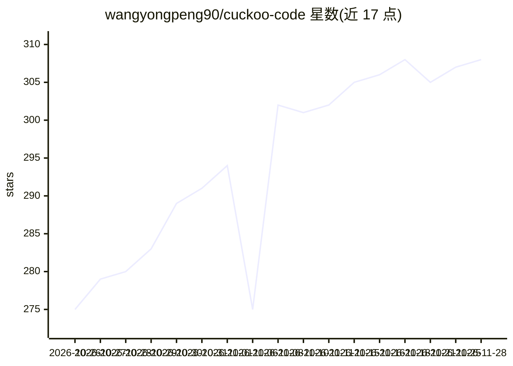

# wangyongpeng90/cuckoo-code

⭐ 308 · HTML · NOASSERTION · 推送 2026-11-27 · [GitHub](https://github.com/wangyongpeng90/cuckoo-code) · 个人维护 · 中文 README

**给开发者的零 Token 成本本地 Agent 桌面端：网页版 AI 执行本地工具**

基于 Electron 的桌面应用，将 DeepSeek/Claude 等网页版聊天界面嵌入本地窗口并注入覆盖层，通过系统提示词引导 AI 生成 `cuckoo` JavaScript 代码块形式的工具调用，经用户确认后在本地沙箱执行并把结果回传，形成 Agent 循环。工具涵盖读写文件、glob/grep 搜索、bash/pwsh 命令、MySQL 查询、webFetch、MCP 调用等，含子代理、Skill/Rules 机制与命令超时、危险命令确认等安全限制。不使用 API Key，依赖网页版账号。

## 筛选速览

| 维度 | 判定 | 备注 |
|---|---|---|
| AI 角色 | `ai-native` | 本体是模型或模型工具 |
| 许可风险 | `none` | NOASSERTION |
| 部署形态 | `None` |  |
| 模型依赖 | — | README 未给出锁定关系 |
| 硬件要求 | — | 无带数字的原话,不猜 |
| 安装摩擦 | `low` | 无编译、无系统依赖或容器化 |
| 成熟度 | — | 结构信号不足 |

## 能力要点

- 通过网页版账号驱动，无需 API Key（零 Token 计费成本）
- 内置 read/write/edit/bash/pwsh/mysql/MCP 等 20 种工具的沙箱执行系统
- 对齐 Claude Code 的 Skill/子代理/Rules 机制（项目级与用户级目录）
- 多平台 Provider 框架，支持导入自定义 Provider 接入其他网页版 AI

## 适用场景

- 让网页版 AI 直接读写和修改本地项目文件、执行命令
- 接入自建的 MCP server 扩展 AI 可调用的工具
- 通过项目级 Skill 和 Rules 沉淀团队开发流程规范
- 多窗口管理多个网页版 AI 平台的并行任务

## 场景标签

`编码 Agent` · 领域:编码与开发

## 证据(README 行号)

> L19: **Cuckoo Code** 是一个零 Token 成本的 AI Agent 桌面端。
> L84: 不只是聊天。AI 可以读写文件、搜索代码、执行命令、查询数据库、调用 MCP 工具，并依据执行结果继续下一步，形成"思考 → 行动 → 观察 → 再行动"的 Agent 循环。
> L101: - **工具调用系统**：AI 可调用读写文件、搜索代码、执行命令、查询数据库等工具

## 星数曲线

2026-10-26 275 → 2026-11-28 308（+33）

---
*卡片 v1 · prompt 1.4 · 生成 2026-11-25 · 置信度 high · 依据 README sha `476473dfbed2` · [字段定义](../../DATASET.md)*
