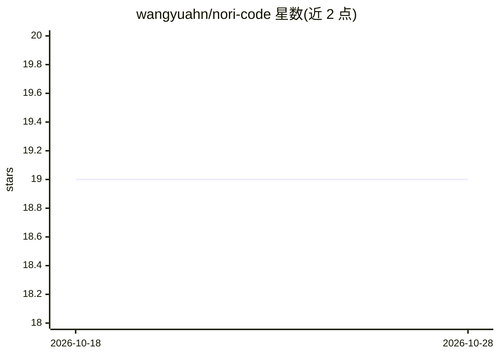

# wangyuahn/nori-code

⭐ 19 · TypeScript · MIT · 推送 2026-09-24 · [GitHub](https://github.com/wangyuahn/nori-code) · 个人维护 · 中文 README

**面向持久多 agent 团队的编码助手（CLI/TUI + Electron 桌面）**

从 Kimi Code CLI（MIT）fork 的编码 agent 工作区：Nori Code 为终端 CLI/TUI，Nori Work 为 Electron 桌面端。核心机制是 Team Engineering——通过 TeamCreate 建立常设部门树（深度默认 2 最大 5），先 Discuss 后 Assign，讨论期间写文件与 shell 工具对全员禁用；成员间用 TeamChat/TeamDM 通信，会话以 parent_session_id 构成可挂载的森林。兼容任意 OpenAI 兼容提供商，支持 MCP、Skills、Obsidian 兼容记忆库。README 自称早期项目，LSP 与 Git 功能被作者描述为毛坯，v2 已删除 SubAgent 派发路径。

## 筛选速览

| 维度 | 判定 | 备注 |
|---|---|---|
| AI 角色 | `ai-native` | 本体是模型或模型工具 |
| 许可风险 | `permissive` | MIT |
| 部署形态 | `library` | 以包/库形式分发 |
| 模型依赖 | — | README 未给出锁定关系 |
| 硬件要求 | — | 无带数字的原话,不猜 |
| 安装摩擦 | `low` | 无编译、无系统依赖或容器化 |
| 成熟度 | `idea` | |

## 能力要点

- TeamCreate/TeamDecide/TeamAssign 等团队工具构建持久部门树
- Discuss 期间 Write/Edit/Bash 等写操作对包括主席在内全员禁用
- 会话森林（parent_session_id 挂载）在 TUI /map 与 Web Map 中可视化
- 兼容任意 OpenAI 兼容提供商（本地或云端）
- Obsidian 兼容记忆库（nori_memory_search / nori_memory_write）

## 适用场景

- 让多个常设 agent 成员先讨论再并行写码并互相同步
- 用会话地图管理跨会话的部门拓扑与身份
- 在终端或桌面端运行多 agent 协作的编码工作流

## 场景标签

`编码 Agent` `多智能体` `Agent 记忆` · 领域:Agent 开发

## 证据(README 行号)

> L5: Nori is a coding-agent workspace forked from Kimi Code CLI (MIT). Nori Code is the terminal CLI/TUI; Nori Work is th
> L29: Typical flow:
> L95: |**Shape**|Terminal TUI + local web + Electron desktop|Terminal CLI, also wired into ChatGPT / IDE / cloud|Terminal

## 星数曲线

2026-10-18 19 → 2026-10-28 19（+0）

---
*卡片 v1 · prompt 1.4 · 生成 2026-10-28 · 置信度 high · 依据 README sha `58784b215430` · [字段定义](../../DATASET.md)*
