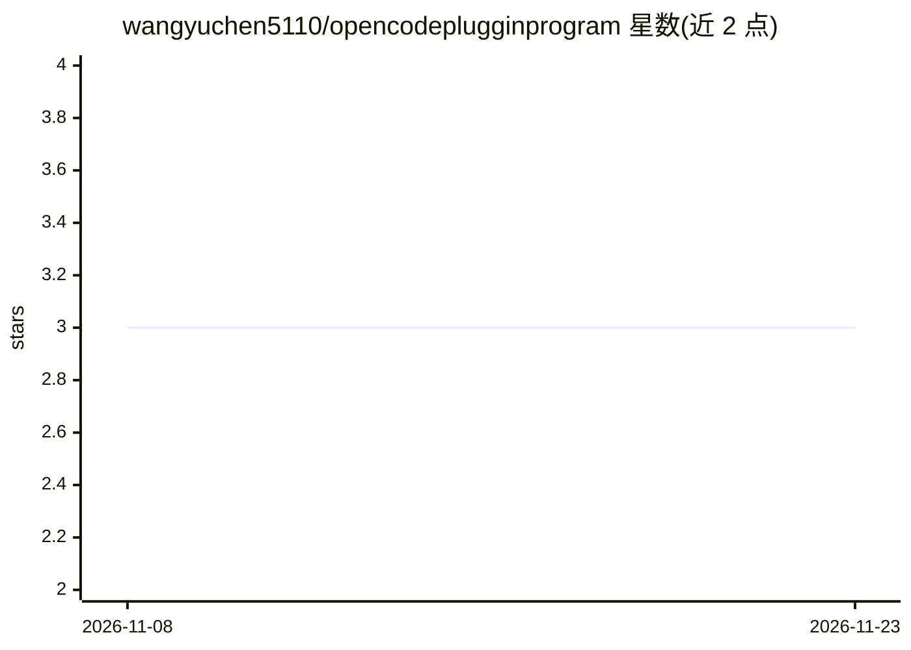

# wangyuchen5110/opencodeplugginprogram

⭐ 3 · JavaScript · MIT · 推送 2026-11-13 · [GitHub](https://github.com/wangyuchen5110/opencodeplugginprogram) · [官网](https://github.com/marketplace/actions/skills-doctor) · 个人维护 · 中文 README

**审计 agent skills 隐藏 token 成本的本地 CLI 工具**

skills-doctor 测量每个 agent skill 在每步注入系统提示的 token 开销：统计 shadowed 重复、目录冲突、超长描述、失效引用与无效 frontmatter，并给出裁剪计划（保留路由句、优先隐藏冗余 skill）。以 CLI、OpenCode 插件、MCP server 与 GitHub Action 形式提供；plan 为纯计算，无 LLM 调用，100% 本地运行，无遥测。支持从 OpenCode、Claude Code、Grok、Cursor 等多个 skill root 自动发现。

## 筛选速览

| 维度 | 判定 | 备注 |
|---|---|---|
| AI 角色 | `ai-ecosystem` | LLM/agent 周边工具 |
| 许可风险 | `permissive` | MIT |
| 部署形态 | `library` | 以包/库形式分发 |
| 模型依赖 | — | README 未给出锁定关系 |
| 硬件要求 | — | 无带数字的原话,不猜 |
| 安装摩擦 | `low` | 无编译、无系统依赖或容器化 |
| 成熟度 | — | 结构信号不足 |

## 能力要点

- 量化每步注入的 description token 成本并输出裁剪计划（预算默认 1200 tokens/step）
- fix 仅将 shadowed 定义移入可逆的归档目录，不改动生效 skill
- 同一输入产出确定性结果，报告可在 CI 中 diff
- CLI / OpenCode 插件 / MCP server / GitHub Action 四种使用形态

## 适用场景

- 在 CI 中检查 skill 预算超标或失效引用并使构建失败
- 为 OpenCode/Claude Code 等多个 agent 清点 skill 来源与优先级
- 多个 skill 定义冲突时找出实际生效的那个并归档冗余项

## 场景标签

 · 领域:开发者工具/Agent 工程效率

## 证据(README 行号)

> L29: `skills-doctor` measures the exact cost, shows which definition actually wins, and gives you a concrete plan to cut
> L44: |**Update**|sync skills from HTTP catalogs with a lockfile, drift detection and `--prune`|
> L46: |**Run it**|CLI · OpenCode plugin (1.x/2.x/Desktop) · MCP server · DeepSeek Harness skill|

## 星数曲线

2026-11-08 3 → 2026-11-23 3（+0）

---
*卡片 v1 · prompt 1.4 · 生成 2026-11-21 · 置信度 high · 依据 README sha `193bb3dd55c6` · [字段定义](../../DATASET.md)*
