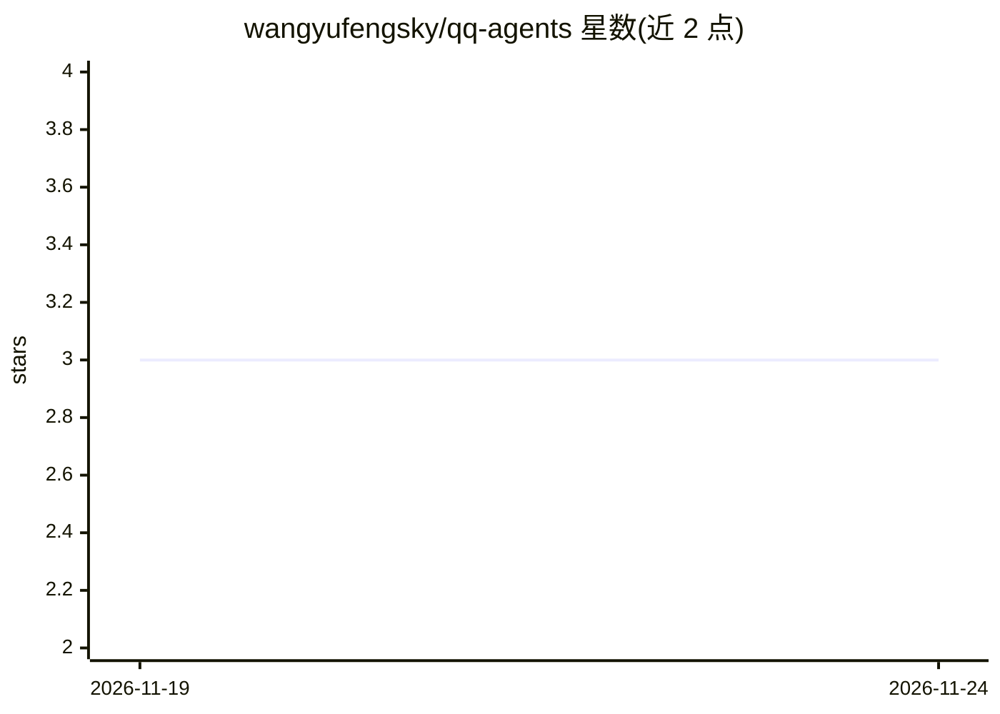

# wangyufengsky/qq-agents

⭐ 3 · JavaScript · MIT · 推送 2026-11-21 · [GitHub](https://github.com/wangyufengsky/qq-agents) · 个人维护 · 中文 README

**自托管多角色 QQ AI 机器人管理台：每角色绑定独立 QQ 号**

自托管应用，通过 NapCat/OneBot 为每个 AI 角色连接独立 QQ 账号，在本机网页管理台配置人格、长期记忆（经历/日记/人物卡/Self）、群聊与私聊白名单和权限。支持 DSH、Codex CLI、Antigravity CLI 和任意 OpenAI 兼容 API 四类后端，可接入外部 MCP 工具。新配置默认隔离并全局暂停，需逐级放开发言。需 Node.js 24+，扩展后端需 fork 修改源码，明确不支持多租户与托管服务。

## 筛选速览

| 维度 | 判定 | 备注 |
|---|---|---|
| AI 角色 | `ai-native` | 本体是模型或模型工具 |
| 许可风险 | `permissive` | MIT |
| 部署形态 | `self-host` | docker 或自建部署 |
| 模型依赖 | locked-api |  |
| 硬件要求 | — | 无带数字的原话,不猜 |
| 安装摩擦 | `low` | 无编译、无系统依赖或容器化 |
| 成熟度 | — | 结构信号不足 |

## 能力要点

- 每个角色独立绑定 QQ 账号，拥有人格、记忆与日记，跨重启接续会话
- 支持 DSH、Codex、Antigravity CLI 与 OpenAI 兼容 API 四类后端及外部 MCP
- 隔离模式、全局/角色/会话多级暂停与白名单权限控制
- 提供 AI 助手按文档代为安装与备份升级的流程（AI-INSTALL/AI-UPDATE）

## 适用场景

- 在本机运行几个长期存在的 QQ 角色，各自有人格和记忆
- 先隔离配置、确认后再逐步放开发言并随时一键暂停
- 给角色接入外部 MCP 工具、网页浏览和文件资料库

## 场景标签

`聊天机器人` `Agent 记忆` · 领域:Agent 开发

## 证据(README 行号)

> L7: QQ Agents 通过 NapCat / OneBot 为每个 AI 角色连接独立 QQ 账号，在一个本机网页中管理人格、记忆、日记和群聊/私聊权限。支持 DSH、Codex、Antigravity CLI 和 OpenAI 兼容
> L163: - **AI 后端**：生成回复的模型服务，目前支持 DSH（DeepSeek Harness 桌面应用）、Codex（本项目专用的 Codex app-server，独立登录目录）、Antigravity CLI 和任意 Op

## 星数曲线

2026-11-19 3 → 2026-11-24 3（+0）

---
*卡片 v1 · prompt 1.4 · 生成 2026-11-21 · 置信度 high · 依据 README sha `c82b4e3d0f66` · [字段定义](../../DATASET.md)*
