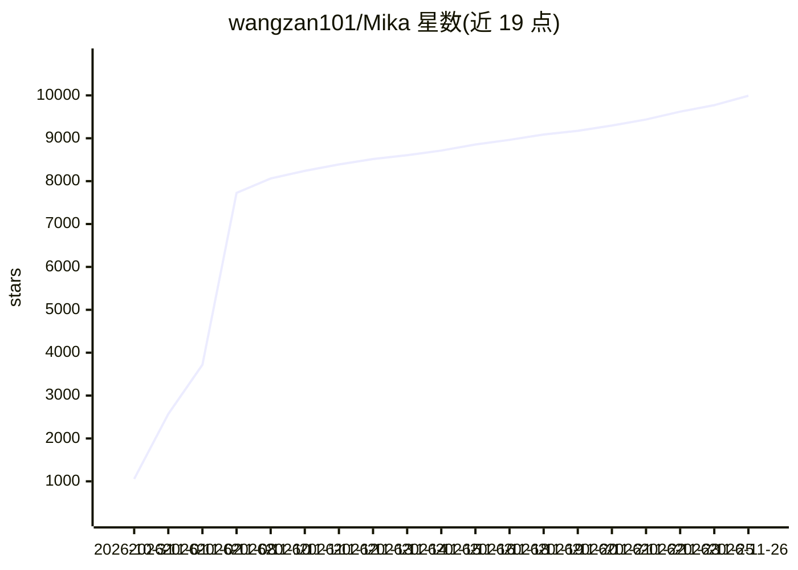

# wangzan101/Mika

⭐ 9,991 · Kotlin · Apache-2.0 · 推送 2026-11-25 · [GitHub](https://github.com/wangzan101/Mika) · [官网](https://mikaphone.com) · 个人维护 · 中文 README

**安卓端任务型 AI 助手：一句话替你操作应用和网页**

运行在 Android 手机上的本地 AI agent：用户用一句话下达任务，Mika 在独立的后台虚拟屏幕上打开应用、点击、输入、滚动，完成发消息、比价加购、总结群聊、订外卖等操作，支付等敏感步骤交回用户确认。通过无障碍方式按屏幕内容找按钮，无需各应用单独适配。无自有服务器，模型走用户自配的 API key 或账号登录；内置中文应用与网站使用知识，APK 形式分发，Apache-2.0 许可。

## 筛选速览

| 维度 | 判定 | 备注 |
|---|---|---|
| AI 角色 | `ai-native` | 本体是模型或模型工具 |
| 许可风险 | `permissive` | Apache-2.0 |
| 部署形态 | `None` |  |
| 模型依赖 | local-ok | 支持本地模型 |
| 硬件要求 | — | 无带数字的原话,不猜 |
| 安装摩擦 | `low` | 无编译、无系统依赖或容器化 |
| 成熟度 | — | 结构信号不足 |

## 能力要点

- 后台虚拟屏幕操作应用，不占用用户当前屏幕
- 内置约 50 个应用与 30 个网站的使用知识文件
- 支持 Ask/Autonomous 两种任务确认模式，完成任务可沉淀为技能复用
- 每会话提供 arm64 Linux 沙箱，可运行 Python/Node/shell 处理文件

## 适用场景

- 一句话让 AI 在微信里找联系人并发消息
- 按条件在购物网站选品并加入购物车
- 自动总结微信群聊或博主近期动态
- 定时执行闹钟、天气提醒等周期任务

## 场景标签

`AI 助手` `GUI 自动化` · 领域:效率与自动化

## 证据(README 行号)

> L5: **An AI assistant on your phone: say what you need, and it works your apps and the web until it's done.**
> L51: |🔒 **Your data stays on your phone**|There is no Mika server; use your own model API key, or sign in with a ChatGPT
> L94: Presets for DeepSeek, 通义千问, Kimi, 智谱, 智谱 Coding Plan, 硅基流动, 火山方舟, MiniMax, 阶跃星辰, 腾讯混元, 百度千帆, OpenRouter, OpenDesign

## 星数曲线

2026-10-31 1,055 → 2026-11-26 9,991（+8,936）

---
*卡片 v1 · prompt 1.4 · 生成 2026-11-26 · 置信度 high · 依据 README sha `2b75cc8e9d97` · [字段定义](../../DATASET.md)*
