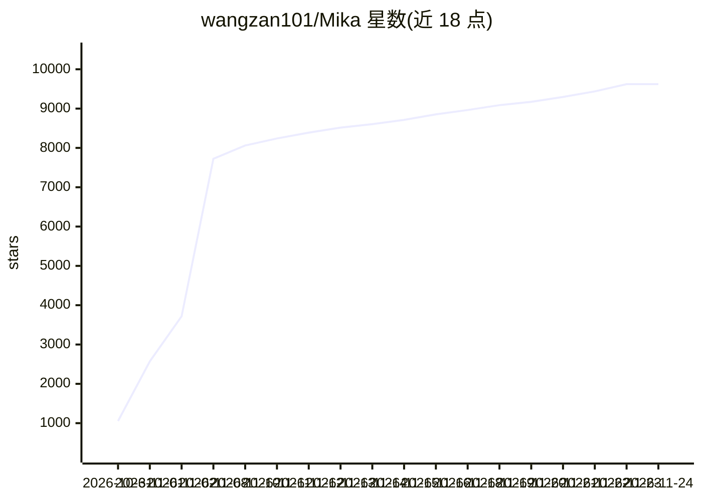

# wangzan101/Mika

⭐ 9,621 · Kotlin · Apache-2.0 · 推送 2026-11-22 · [GitHub](https://github.com/wangzan101/Mika) · [官网](https://mikaphone.com) · 个人维护 · 中文 README

**Android 端设备内 AI 助手：代你操作应用与网页完成任务**

安装在 Android 手机上的 AI 助手应用，从一句话指令出发，在隐藏的后台屏幕上打开应用、点击、输入、滚动，代用户完成发消息、比价加购、总结群聊、订外卖等任务；也可在内置浏览器中对当前网页下达指令。通过无障碍方式按视觉识别界面元素，无需各应用的 API 适配。无官方服务器：用户自配模型 API key 或用 ChatGPT/xAI/OpenRouter 账号登录，数据加密存储在本机。提供 Releases APK 安装包，操作手机应用需 Android 12+ 并配对无线调试。

## 筛选速览

| 维度 | 判定 | 备注 |
|---|---|---|
| AI 角色 | `ai-native` | 本体是模型或模型工具 |
| 许可风险 | `permissive` | Apache-2.0 |
| 部署形态 | `None` |  |
| 模型依赖 | local-ok | 支持本地模型 |
| 硬件要求 | — | 无带数字的原话,不猜 |
| 安装摩擦 | `low` | 无编译、无系统依赖或容器化 |
| 成熟度 | — | 结构信号不足 |

## 能力要点

- 后台隐藏屏幕执行操作，不打断用户当前使用
- 内置约 50 个应用与 29 个网站的使用知识，非适配应用也可操作
- 付费动作前默认确认（Ask mode），可切换 Autonomous mode
- 每会话提供 arm64 Linux 沙箱，可运行 Python/Node/shell 处理文件

## 适用场景

- 一句话让助手在微信里找联系人并发消息
- 购物网站上按条件挑商品加购物车并在付款前停下确认
- 后台读完群聊并总结今天讨论内容
- 通过电脑上的 CLI/Skill 或 MCP 把任务交给手机执行

## 场景标签

`AI 助手` `GUI 自动化` `浏览器自动化` · 领域:效率与自动化

## 证据(README 行号)

> L5: **An AI assistant on your phone: say what you need, and it works your apps and the web until it's done.**
> L48: |🧩 **Works with any app**|Looks at the screen and finds buttons the way a person does: no app APIs, no per-app inte
> L51: |🔒 **Your data stays on your phone**|There is no Mika server; use your own model API key, or sign in with a ChatGPT

## 星数曲线

2026-10-31 1,055 → 2026-11-24 9,621（+8,566）

---
*卡片 v1 · prompt 1.4 · 生成 2026-11-23 · 置信度 high · 依据 README sha `32479793b054` · [字段定义](../../DATASET.md)*
