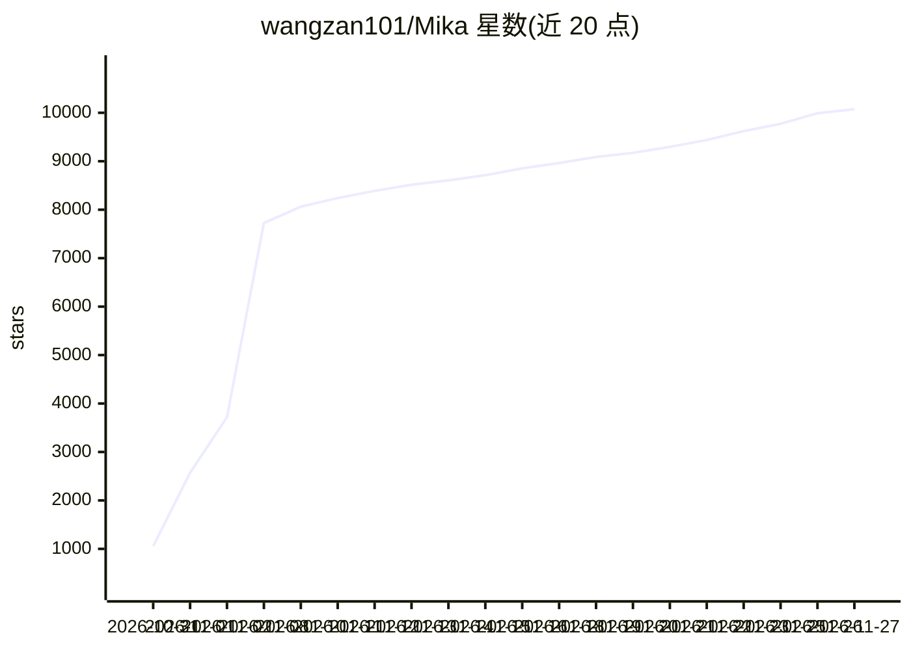

# wangzan101/Mika

⭐ 10,074 · Kotlin · Apache-2.0 · 推送 2026-11-26 · [GitHub](https://github.com/wangzan101/Mika) · [官网](https://mikaphone.com) · 个人维护 · 中文 README

**手机上的端侧 AI Agent：一句话操控应用与网页替你办事**

运行在 Android 手机上的 AI 助手应用，在独立的后台屏幕上模拟人的方式查看屏幕、点击、输入和滑动，从而操作任意应用与网页（不依赖应用 API 或逐应用集成）。任务执行分 Ask 模式（花钱前确认）与 Autonomous 模式；提供内置浏览器、按对话隔离的 Linux 沙箱（运行 Python/Node/shell）、定时任务、语音输入（用系统自带识别或厂商语音模型）、以及计算机侧通过 CLI/Skill/MCP 下发任务。无官方服务器，模型需用户自配 API key 或账号登录；操作第三方应用可能违反其服务条款。

## 筛选速览

| 维度 | 判定 | 备注 |
|---|---|---|
| AI 角色 | `ai-native` | 本体是模型或模型工具 |
| 许可风险 | `permissive` | Apache-2.0 |
| 部署形态 | `None` |  |
| 模型依赖 | local-ok | 支持本地模型 |
| 硬件要求 | — | 无带数字的原话,不猜 |
| 安装摩擦 | `low` | 无编译、无系统依赖或容器化 |
| 成熟度 | — | 结构信号不足 |

## 能力要点

- 后台屏幕操控：不占用主屏幕，可与任意应用/网页交互，无逐应用集成
- 无 Mika 服务器：数据经用户自配的模型服务商，密钥与记忆加密存于手机
- 内置约 50 个应用与 29 个网站的用法知识，未列出的应用仍可操作
- Linux 沙箱（arm64）支持 Python/Node/shell；计算机侧可经 CLI/MCP 下发任务

## 适用场景

- 一句话让它在微信/淘宝/外卖等应用里完成发消息、比价、下单等操作
- 后台滚动阅读群聊并总结今日讨论
- 在手机浏览网页时对当前页面直接下达指令
- 通过电脑上的 AI Agent 远程让手机完成设置与任务

## 场景标签

`AI 助手` `GUI 自动化` `浏览器自动化` · 领域:效率与自动化

## 证据(README 行号)

> L5: **An AI assistant on your phone: say what you need, and it works your apps and the web until it's done.**
> L21: From one sentence, Mika opens WeChat on its background screen, finds the contact and sends the message
> L48: |🧩 **Works with any app**|Looks at the screen and finds buttons the way a person does: no app APIs, no per-app inte
> L94: Presets for DeepSeek, 通义千问, Kimi, 智谱, 智谱 Coding Plan, 硅基流动, 火山方舟, MiniMax, 阶跃星辰, 腾讯混元, 百度千帆, OpenRouter, OpenDesign

## 星数曲线

2026-10-31 1,055 → 2026-11-27 10,074（+9,019）

---
*卡片 v1 · prompt 1.4 · 生成 2026-11-27 · 置信度 high · 依据 README sha `2d4a34e6beb1` · [字段定义](../../DATASET.md)*
