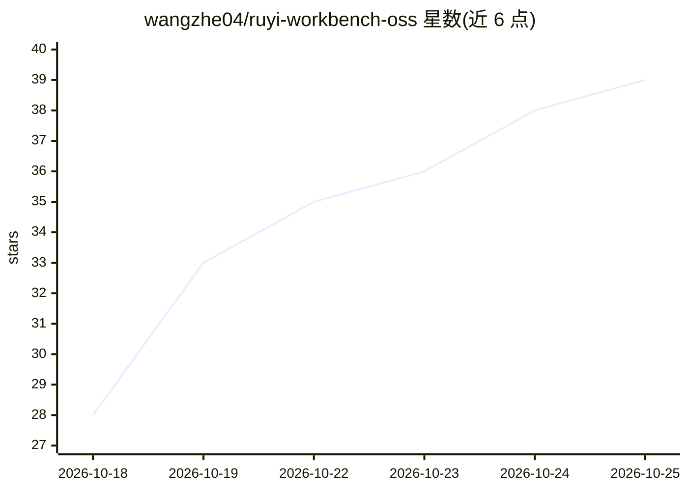

# wangzhe04/ruyi-workbench-oss

⭐ 39 · JavaScript · Apache-2.0 · 推送 2026-10-24 · [GitHub](https://github.com/wangzhe04/ruyi-workbench-oss) · 个人维护 · 中文 README

**Windows 本地 AI 工作台：让模型在电脑上动手办事并可撤销**

面向不写代码的知识工作者与进阶用户的 Windows 桌面 AI 工作台：接入 OpenAI 兼容 / Anthropic Messages 端点（含本机 Ollama / LM Studio、内网 vLLM）或 Claude Code / Kimi Code 命令行，让模型读写文件、跑脚本、操作 Office 与桌面（可选 ACC 组件 108 个桌面工具），支持 8 套多 Agent 编排模板与管家线程管理。关键机制：120 个原生工具三级审批、五档权限、文件检查点可逐条/整轮回滚、离线可用、零 npm 依赖单文件后端。限制：仅 Windows，桌面控制组件可选安装。

## 筛选速览

| 维度 | 判定 | 备注 |
|---|---|---|
| AI 角色 | `ai-native` | 本体是模型或模型工具 |
| 许可风险 | `permissive` | Apache-2.0 |
| 部署形态 | `desktop` | 安装包/桌面程序 |
| 模型依赖 | local-ok | 支持本地模型 |
| 硬件要求 | — | 无带数字的原话,不猜 |
| 安装摩擦 | `low` | 无编译、无系统依赖或容器化 |
| 成熟度 | — | 结构信号不足 |

## 能力要点

- 接任意 OpenAI 兼容 / Anthropic Messages 端点或 Claude Code / Kimi Code CLI 引擎
- 120 个原生工具 + 可选 ACC 桌面/Office 108 个工具，操作前审批、改动可撤销
- 8 套多 Agent 编排模板、10 种节点角色、5 种质量门
- 离线优先、零 npm 运行时依赖、NDJSON 审计日志

## 适用场景

- 一句话让 AI 读 CSV 写报告、归档文件夹、生成周报
- 多 Agent 调研、代码审计与选型，画布上实时看协作进度
- 内网/合规环境下接内网模型端点，纯离线使用
- 交给管家线程盯日常事务，到期提醒再回来处理

## 场景标签

`多智能体` `GUI 自动化` `AI 助手` · 领域:Agent 开发

## 证据(README 行号)

> L15: **如意（Ruyi）** 是一个 clean-room 实现的 Windows 本地 AI 工作台。给它一个能用的模型：Anthropic Messages 或 OpenAI 兼容端点（云端 API、内网 vLLM、本机 Olla
> L64: 市面上的 AI 工具大多是这三类之一：云端聊天应用（只能说）、编程 CLI Agent（给程序员用）、云端自动化 Agent（活在别人的服务器上）。如意占的是它们都没占的位置：**在本机、真动手、可撤销、不写代码的人也能放心用**
> L76: - **不写代码的知识工作者**：整理文件夹、合并 Excel、OCR 扫描件、汇总 PDF、写周报、做汇报大纲、按时提醒。精简模式把术语全换成人话，常用的事有一键任务卡。

## 星数曲线

2026-10-18 28 → 2026-10-25 39（+11）

---
*卡片 v1 · prompt 1.4 · 生成 2026-10-25 · 置信度 mid · 依据 README sha `4760e1772299` · [字段定义](../../DATASET.md)*
