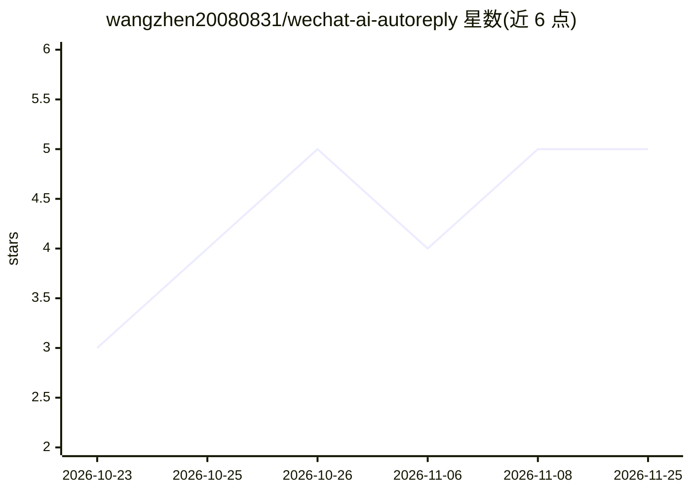

# wangzhen20080831/wechat-ai-autoreply

⭐ 5 · Python · MIT · 推送 2026-10-16 · [GitHub](https://github.com/wangzhen20080831/wechat-ai-autoreply) · 个人维护 · 中文 README

**微信 4.x 个人号 DeepSeek 自动回复机器人（Windows）**

面向想在微信个人号上自动回复消息的个人用户：通过读取微信 4.x 本地数据库收消息，用 UIA/OCR 驱动真实客户端窗口发送，不注入不 Hook。仅回复白名单用户，群聊需被 @；提供会话记忆（12 轮/72 小时）、通知材料库（支持 docx/pdf/图片，扫描件走 Windows 自带 OCR）、隐私闸门（拦截身份证号/成片手机号/花名册）与失败补回。依赖 wechatauto-replica（Apache-2.0）完成底层收发，仅支持 Windows 常开、不锁屏环境，非官方接口存在封号风险。

## 筛选速览

| 维度 | 判定 | 备注 |
|---|---|---|
| AI 角色 | `ai-native` | 本体是模型或模型工具 |
| 许可风险 | `permissive` | MIT |
| 部署形态 | `desktop` | 安装包/桌面程序 |
| 模型依赖 | locked-api |  |
| 硬件要求 | — | 无带数字的原话,不猜 |
| 安装摩擦 | `low` | 无编译、无系统依赖或容器化 |
| 成熟度 | — | 结构信号不足 |

## 能力要点

- 读本地数据库收消息 + UIA/OCR 操作真实客户端发送，不注入不 Hook
- 白名单 + 群 @ 才回复，黑名单优先级最高
- 通知材料库支持 PDF/docx/图片，扫描件用 Windows 自带 OCR 离线识别
- 隐私闸门拦截身份证号、成片手机号与花名册类文件

## 适用场景

- 让 AI 以我的人设自动回复好友私聊
- 班级群里被 @ 时自动回答通知类问题
- 24 小时挂机处理消息，配合免打扰时段与冷却限速

## 场景标签

`聊天机器人` · 领域:对话与助手

## 证据(README 行号)

> L3: 别人给你的微信发消息，DeepSeek 自动回。24 小时不需要你盯着。
> L15:  微信 4.x 的数据库解密读取与 UIA/OCR 发送由它完成；本项目做的是它上面那一层——
> L23: 微信官方没有给个人号开放任何自动收发消息的接口。本项目走的是"读微信本地数据库 + 模拟人操作窗口"，

## 星数曲线

2026-10-23 3 → 2026-11-25 5（+2）

---
*卡片 v1 · prompt 1.4 · 生成 2026-11-21 · 置信度 high · 依据 README sha `bd14f9719723` · [字段定义](../../DATASET.md)*
