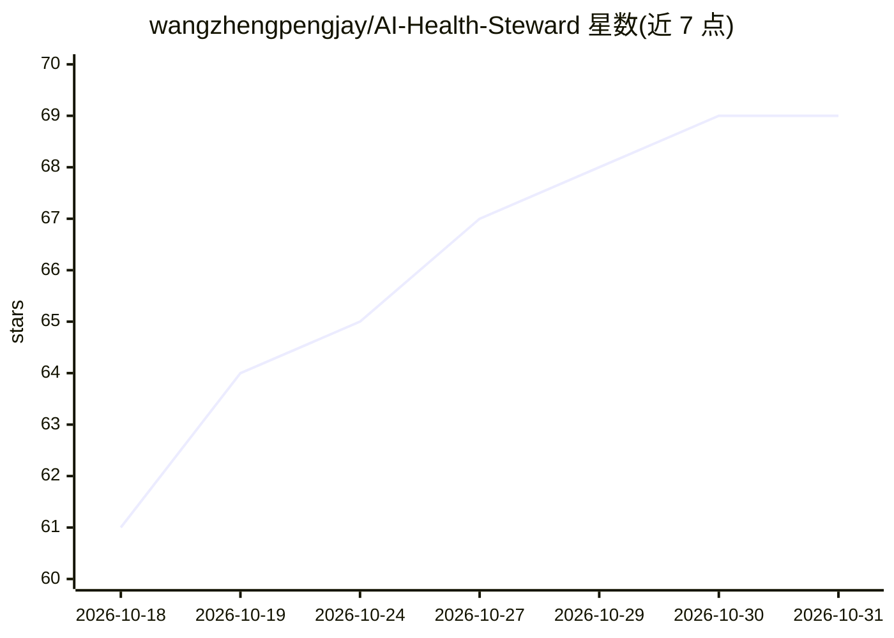

# wangzhengpengjay/AI-Health-Steward

⭐ 69 · Python · MIT · 推送 2026-10-22 · [GitHub](https://github.com/wangzhengpengjay/AI-Health-Steward) · [官网](https://wangzhengpengjay.github.io/AI-Health-Steward/) · 个人维护 · 中文 README

**可私有化部署的家庭 AI 健康管家：健康画像 + AI 咨询**

面向家庭用户自建部署的健康管理系统：拍照上传体检报告，多模态 AI 自动结构化提取指标，构建按成员隔离的人维度健康画像；提供基于画像数据的 AI 咨询（意图路由 + 工具调用）、指标趋势与危急值预警、9 大量表自测、RAG 报告语义检索与飞书集成。数据存本地服务器，模型可选 OpenAI 兼容 API 或本地 Ollama；Docker 部署，最低 2 核 2GB，Capacitor 打包移动端以配对码绑定。

## 筛选速览

| 维度 | 判定 | 备注 |
|---|---|---|
| AI 角色 | `ai-native` | 本体是模型或模型工具 |
| 许可风险 | `permissive` | MIT |
| 部署形态 | `None` |  |
| 模型依赖 | local-ok | 支持本地模型 |
| 硬件要求 | — | 无带数字的原话,不猜 |
| 安装摩擦 | `low` | 无编译、无系统依赖或容器化 |
| 成熟度 | — | 结构信号不足 |

## 能力要点

- 拍照上传体检报告，AI 自动结构化抽取关键指标
- 基于个人画像数据的 AI 健康咨询与长期会话记忆
- 报告自动向量化，支持 RAG 语义检索历史报告
- 多成员数据隔离，配对码绑定手机端访问

## 适用场景

- 我帮全家人集中管理体检报告和健康指标
- 我想用 AI 解读化验单但不把数据传到别人云上
- 追踪血压血糖趋势并在异常时收到提醒

## 场景标签

`RAG` `多模态` `文档解析` · 领域:知识与检索

## 证据(README 行号)

> L10: > **市面上的健康 App 都是黑盒。你的化验结果、诊断、用药记录上传到别人的云上，被打包成产品卖。AI Health Steward 反过来——数据存在你自己的服务器上，AI 由你选择，手机也能用。**
> L83: - **多模态报告导入** — 拍照上传体检报告/化验单，AI 自动结构化抽取关键指标
> L85: - **AI 健康咨询** — 意图路由 + 工具调用，回答基于你的实际画像数据

## 星数曲线

2026-10-18 61 → 2026-10-31 69（+8）

---
*卡片 v1 · prompt 1.4 · 生成 2026-10-24 · 置信度 high · 依据 README sha `492d6888c6cc` · [字段定义](../../DATASET.md)*
