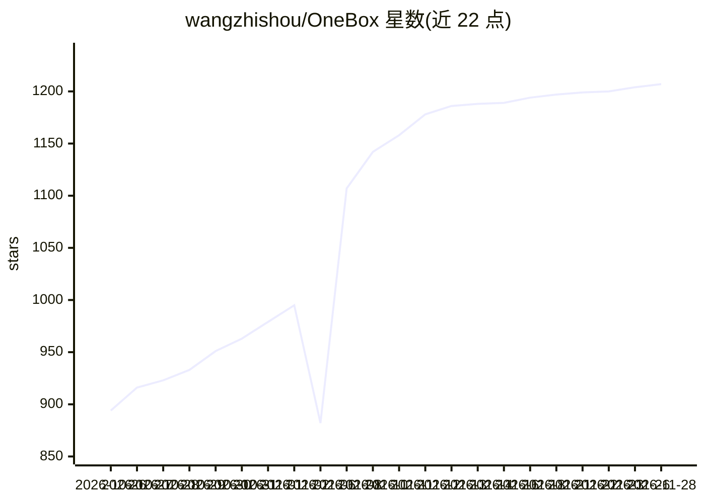

# wangzhishou/OneBox

⭐ 1,207 · Kotlin · Apache-2.0 · 推送 2026-11-27 · [GitHub](https://github.com/wangzhishou/OneBox) · [官网](https://www.oneboxable.com) · 个人维护 · 中文 README

**安卓端 AI 智能体工具箱：语音驱动 90+ 内置工具**

面向安卓用户的一站式工具箱应用，内置 107 个功能模块：AI 助手通过自然语言调用 90+ 应用内本地工具（PDF、图片编辑、文件管理、记账），支持多模型聊天与多步任务链。设备端 AI 部分经 LiteRT-LM 运行 Gemma 3 1B / Qwen3 0.6B 离线聊天，腾讯 Hy-MT2 1.8B 离线翻译，PP-OCRv6 离线照片文字识别；用户提供任意 OpenAI 兼容 API key 即可使用完整助手。另有 124 种文件格式查看器。国内发行版编译 LiteRT-LM 桩，本地聊天与翻译缺失，OCR 各版本均有。

## 筛选速览

| 维度 | 判定 | 备注 |
|---|---|---|
| AI 角色 | `ai-native` | 本体是模型或模型工具 |
| 许可风险 | `permissive` | Apache-2.0 |
| 部署形态 | `None` |  |
| 模型依赖 | — | README 未给出锁定关系 |
| 硬件要求 | — | 无带数字的原话,不猜 |
| 安装摩擦 | `medium` | 含编译或系统依赖之一 |
| 成熟度 | — | 结构信号不足 |

## 能力要点

- AI Agent 调用 90+ 应用内本地工具，多步任务链在设备端执行
- 离线模型运行：Gemma 3 1B / Qwen3 0.6B 聊天、Hy-MT2 翻译、PP-OCRv6 照片识别
- 自带 OpenAI 兼容 API key 即可使用完整助手与 Agent
- 107 个功能模块，支持 124 种文件格式的内置查看

## 适用场景

- 语音记账、图片转 PDF、生成待办等日常任务一句话完成
- 无网络环境下离线聊天、翻译和读取照片中的文字
- 免装多个应用直接打开文档、音视频与压缩包
- 截图驱动多模态模型实现 UI 自动化

## 场景标签

`AI 助手` `聊天机器人` `OCR` `GUI 自动化` · 领域:效率与自动化

## 证据(README 行号)

> L40: - **An agent that drives the tools**: the AI agent can invoke 90+ in-app local tools (PDF processing, image editing
> L44: - **Models that run on the phone — fully offline**: download a local model (Gemma 3 1B or Qwen3 0.6B) inside the ap

## 星数曲线

2026-10-26 894 → 2026-11-28 1,207（+313）

---
*卡片 v1 · prompt 1.4 · 生成 2026-11-26 · 置信度 high · 依据 README sha `0ca4a17d2ac5` · [字段定义](../../DATASET.md)*
