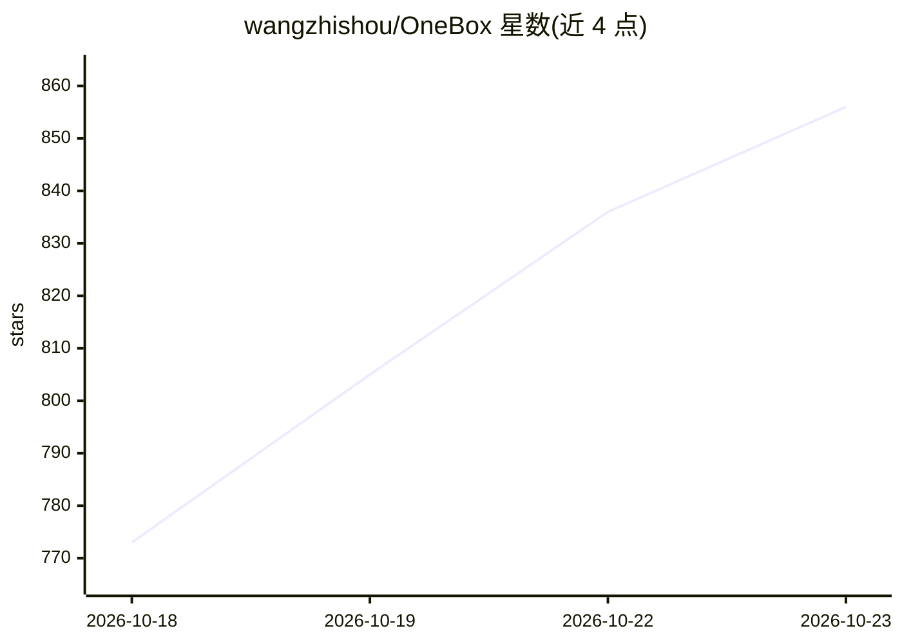

# wangzhishou/OneBox

⭐ 856 · Kotlin · Apache-2.0 · 推送 2026-10-22 · [GitHub](https://github.com/wangzhishou/OneBox) · [官网](https://www.oneboxable.com) · 个人维护 · 中文 README

**安卓一站式 AI 智能体与工具箱应用（104 个功能模块）**

面向 Android 用户的免费工具箱应用，含 104 个功能模块，覆盖图像编辑、滤镜、格式转换、PDF/OCR、二维码、记账、待办、象棋等。内置 AI 智能体可调用 90+ 本地工具链式执行多步任务；支持 OpenAI 兼容 API key（含 Gemini/OpenRouter 免费档）与本地离线模型（Gemma 3 1B / Qwen3 0.6B，经 LiteRT-LM 端侧推理）。本地工具完全在设备上运行，仅与模型的对话走网络。通过 Google Play、F-Droid 及国内应用商店分发。

## 筛选速览

| 维度 | 判定 | 备注 |
|---|---|---|
| AI 角色 | `ai-enhanced` | 去掉 AI 部分产品仍成立 |
| 许可风险 | `permissive` | Apache-2.0 |
| 部署形态 | `None` |  |
| 模型依赖 | — | README 未给出锁定关系 |
| 硬件要求 | — | 无带数字的原话,不猜 |
| 安装摩擦 | `medium` | 含编译或系统依赖之一 |
| 成熟度 | — | 结构信号不足 |

## 能力要点

- AI 智能体可调用 90+ 应用内本地工具并链式执行多步任务
- 支持 OpenAI 兼容 API key 及本地离线模型（LiteRT-LM 端侧推理）
- 104 个功能模块，本地工具全程在设备上运行
- 画中画机器人窗口展示长任务进度

## 适用场景

- 用一句话让 AI 代为完成图片转 PDF、账单记录等多步操作
- 在手机上离线进行图像编辑、OCR、PDF 处理等本地任务
- 通过单一入口对话多个 LLM，含免费档与自备 key

## 场景标签

 · 领域:移动应用/工具箱

## 证据(README 行号)

> L39: - **An agent that drives the tools**: the AI agent can invoke 90+ in-app local tools (PDF processing, image editing
> L48: OneBox ships **104 feature modules**. Local tools run entirely on-device; only the conversation with your chosen AI

## 星数曲线

2026-10-18 773 → 2026-10-23 856（+83）

---
*卡片 v1 · prompt 1.4 · 生成 2026-10-21 · 置信度 high · 依据 README sha `11981affcc0d` · [字段定义](../../DATASET.md)*
