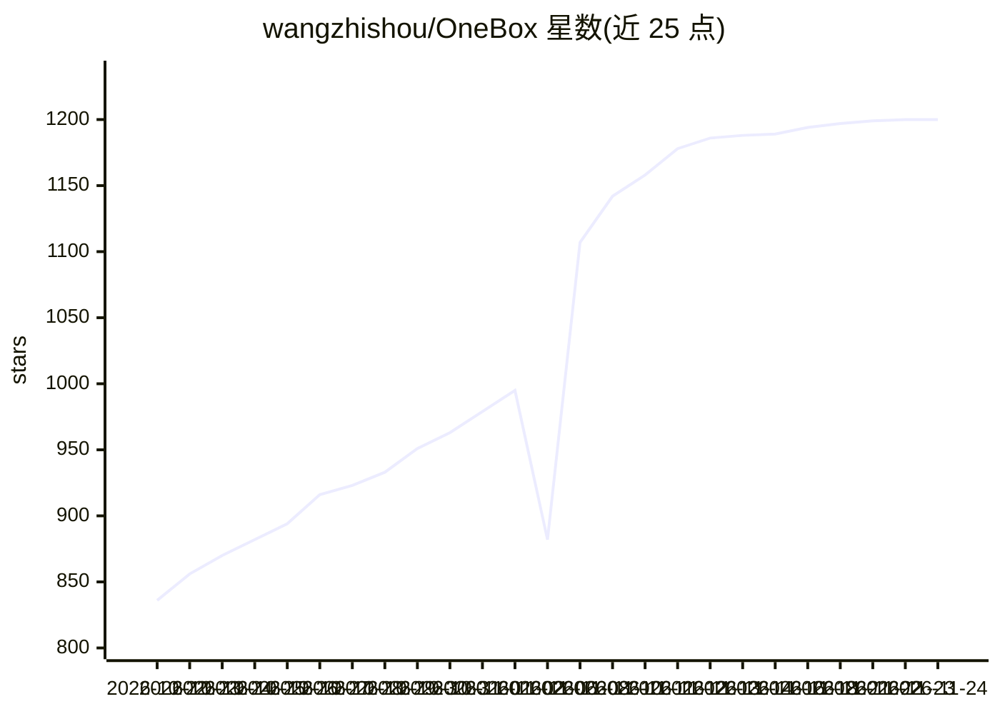

# wangzhishou/OneBox

⭐ 1,200 · Kotlin · Apache-2.0 · 推送 2026-11-21 · [GitHub](https://github.com/wangzhishou/OneBox) · [官网](https://www.oneboxable.com) · 个人维护 · 中文 README

**安卓一站式 AI 智能体与工具箱，语音驱动 90+ 内置工具**

面向安卓用户的免费 AI 智能体与工具箱应用：内置 Agent 可调用 90+ 本地工具（PDF、图像、记账、文件管理等）串联多步任务，并包含多模型聊天、文生图、AI 生成检测、截图驱动的 UI 自动化。本地 AI 通过 LiteRT-LM 运行 Gemma 3 1B / Qwen3 0.6B 实现离线聊天，PP-OCRv6 实现离线拍照识字，Hy-MT2 实现离线翻译；云端模型走 OpenAI 兼容 API 自带密钥。另有 100+ 文件格式查看器与 107 个功能模块。本地工具完全在设备上运行，仅对话流量联网；国内渠道构建版缺少本地聊天/翻译模块。

## 筛选速览

| 维度 | 判定 | 备注 |
|---|---|---|
| AI 角色 | `ai-native` | 本体是模型或模型工具 |
| 许可风险 | `permissive` | Apache-2.0 |
| 部署形态 | `None` |  |
| 模型依赖 | — | README 未给出锁定关系 |
| 硬件要求 | — | 无带数字的原话,不猜 |
| 安装摩擦 | `medium` | 含编译或系统依赖之一 |
| 成熟度 | — | 结构信号不足 |

## 能力要点

- 内置 Agent 链式调用 90+ 本地工具，带每工具超时与迭代上限
- LiteRT-LM 端侧推理：Gemma 3 1B / Qwen3 0.6B 离线聊天，支持导入 .litertlm
- PP-OCRv6 离线拍照识字与 Hy-MT2 1.8B 离线 20 语种翻译
- OpenAI 兼容 API 自带密钥即可解锁全部助手与 Agent 功能

## 适用场景

- 用一句话让 AI 完成图片转 PDF、记账、生成待办等任务
- 无网络环境下离线聊天、翻译与照片识字
- 替代多个独立应用打开 100+ 格式的文件
- 同一入口切换多个主流大模型进行对话

## 场景标签

`聊天机器人` `AI 助手` `图像生成` `OCR` · 领域:对话与助手

## 证据(README 行号)

> L7:  A free AI agent & toolbox for Android: say what you need and the built-in agent drives
> L40: - **An agent that drives the tools**: the AI agent can invoke 90+ in-app local tools (PDF processing, image editing
> L44: - **Models that run on the phone — fully offline**: download a local model (Gemma 3 1B or Qwen3 0.6B) inside the ap

## 星数曲线

2026-10-22 836 → 2026-11-24 1,200（+364）

---
*卡片 v1 · prompt 1.4 · 生成 2026-11-23 · 置信度 high · 依据 README sha `662f52129d3f` · [字段定义](../../DATASET.md)*
