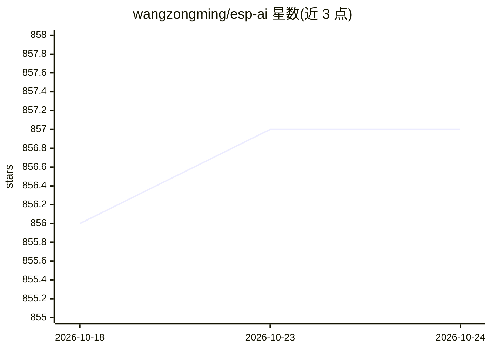

# wangzongming/esp-ai

⭐ 857 · C · MIT · 推送 2026-01-09 · [GitHub](https://github.com/wangzongming/esp-ai) · [官网](https://espai.fun) · 个人维护 · 中文 README

**ESP32 等开发板接入 ASR+LLM+TTS 对话的 Node.js 服务框架**

面向 ESP32 系列开发板（含 esp32s3/esp32c3）与 Arduino/IDF 硬件代码的完整 AI 对话接入方案：服务端基于 Node.js，以依赖形式注入项目，串接 IAT(ASR)→LLM/RAG→TTS 全链路并支持流式交互、对话打断、指令识别与插件化接入任意 LLM/TTS/IAT。支持离线唤醒词、按钮/串口等多种唤醒方式，服务与客户端一对多且各自独立配置。服务端提供 Docker 镜像，客户端固件从 release 下载烧录；另有开放平台提供免费 ASR/TTS/LLM 服务。内置离线唤醒精度为待改进项（建议用天问 ASRPro）。

## 筛选速览

| 维度 | 判定 | 备注 |
|---|---|---|
| AI 角色 | `ai-ecosystem` | LLM/agent 周边工具 |
| 许可风险 | `permissive` | MIT |
| 部署形态 | `desktop` | 安装包/桌面程序 |
| 模型依赖 | — | README 未给出锁定关系 |
| 硬件要求 | — | 无带数字的原话,不猜 |
| 安装摩擦 | `low` | 无编译、无系统依赖或容器化 |
| 成熟度 | — | 结构信号不足 |

## 能力要点

- IAT(ASR)→LLM/RAG→TTS 全链路流式对话，支持打断
- 插件化接入任意 LLM/TTS/IAT 服务
- 可定制离线唤醒词，支持语音/按钮/串口/天问 ASRPro 唤醒
- 服务与客户端一对多，每台硬件独立配置

## 适用场景

- 给 ESP32 玩偶、桌宠等硬件加上语音对话能力
- 搭建低成本 AI 语音机器人开发服务端
- 用插件接入自有 LLM/TTS 服务替代默认服务

## 场景标签

 · 领域:嵌入式/物联网 AI 集成

## 证据(README 行号)

> L21: > Provides a complete AI dialogue solution for your development board, including but not limited to the `IAT(ASR)+L
> L23: For developing the dialogue functionality of robots, you only need to prepare the `IAT(ASR)`, `LLM`, and `TTS` serv
> L47: - ✔️ Plugin-based, allowing integration with any LLM/TTS/IAT using plugins

## 星数曲线

2026-10-18 856 → 2026-10-24 857（+1）

---
*卡片 v1 · prompt 1.4 · 生成 2026-10-21 · 置信度 high · 依据 README sha `1b496be85406` · [字段定义](../../DATASET.md)*
