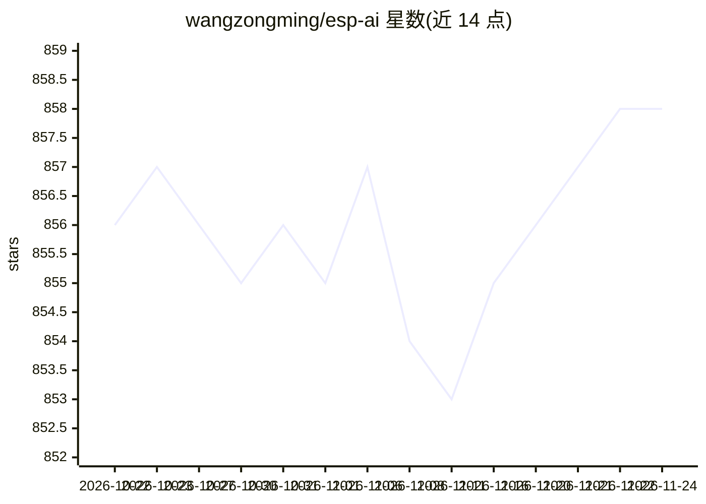

# wangzongming/esp-ai

⭐ 859 · C · MIT · 推送 2026-11-12 · [GitHub](https://github.com/wangzongming/esp-ai) · 个人维护 · 中文 README

**为 ESP32 系列开发板提供 AI 对话接入方案**

为开发板提供完整 AI 对话解决方案的服务端与硬件端项目：覆盖 IAT(ASR)→LLM/RAG→TTS 的对话链路，支持离线唤醒词（语音/按键/串口/天问 ASRPro）、对话打断、全链路流式交互与插件化接入任意 LLM/TTS/IAT 服务。服务端基于 Node.js，硬件代码基于 Arduino/IDF，以依赖方式注入不影响现有工程；支持一服务端对多客户端并独立配置，附带开放平台提供免费 ASR/TTS/LLM 服务与音色克隆。支持 esp32s3/esp32c3。

## 筛选速览

| 维度 | 判定 | 备注 |
|---|---|---|
| AI 角色 | `ai-ecosystem` | LLM/agent 周边工具 |
| 许可风险 | `permissive` | MIT |
| 部署形态 | `desktop` | 安装包/桌面程序 |
| 模型依赖 | — | README 未给出锁定关系 |
| 硬件要求 | — | 无带数字的原话,不猜 |
| 安装摩擦 | `low` | 无编译、无系统依赖或容器化 |
| 成熟度 | — | 结构信号不足 |

## 能力要点

- 完整对话链路 IAT(ASR)→LLM/RAG→TTS，支持打断与流式交互
- 插件机制可接入任意 LLM/TTS/IAT 服务
- 服务端 Docker 部署，客户端依赖从 release 页下载烧录
- 开放平台提供免费 ASR/TTS/LLM 服务与 15 秒音频音色克隆

## 适用场景

- 给 ESP32 机器人加语音对话功能
- 通过语音指令控制家电等设备
- 为 DIY 桌宠/玩偶类硬件接入 AI 对话

## 场景标签

`语音 Agent` `语音识别` `语音合成` `RAG` · 领域:对话与助手

## 证据(README 行号)

> L21: > Provides a complete AI dialogue solution for your development board, including but not limited to the `IAT(ASR)+L
> L25: The server-side code of this project is based on `Node.js`, and the hardware code is based on `Arduino`/`IDF`.

## 星数曲线

2026-10-22 856 → 2026-11-24 858（+2）

---
*卡片 v1 · prompt 1.4 · 生成 2026-11-24 · 置信度 high · 依据 README sha `744edb6a8c4a` · [字段定义](../../DATASET.md)*
