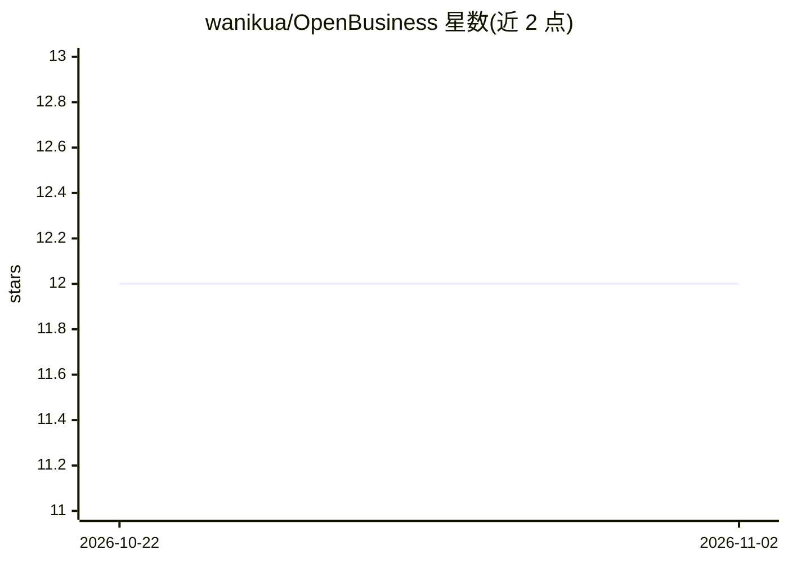

# wanikua/OpenBusiness

⭐ 12 · Python · MIT · 推送 2026-06-02 · [GitHub](https://github.com/wanikua/OpenBusiness) · [官网](https://pypi.org/project/openbusiness/) · 个人维护 · 中文 README

**开源 CLI：采集公开证据并生成带证据标签的商业模式报告**

基于 Python 的商业模式研究命令行工具，发布于 PyPI。输入公司名称、域名与可选股票代码后，通过 Tavily 搜索、Firecrawl 抓取与 SEC EDGAR 收集公开证据，运行 LangGraph 多智能体分析流水线，输出 Markdown 商业模式报告。每条论断被标注为 verified、inferred 或 missing，并对假设做压力测试。支持 OpenAI、Anthropic、DeepSeek 三种 LLM 供应商，提供 SaaS、上市公司、电商等 7 类分析包与 6 种报告模板，可生成英文或简体中文报告。面向创始人、投资人、咨询顾问与研究人员做初步尽调。限制：非人工研究替代品，部分证据源 API key 为可选，缺失时部分数据不可得。

## 筛选速览

| 维度 | 判定 | 备注 |
|---|---|---|
| AI 角色 | `ai-native` | 本体是模型或模型工具 |
| 许可风险 | `permissive` | MIT |
| 部署形态 | `library` | 以包/库形式分发 |
| 模型依赖 | locked-api |  |
| 硬件要求 | — | 无带数字的原话,不猜 |
| 安装摩擦 | `low` | 无编译、无系统依赖或容器化 |
| 成熟度 | — | 结构信号不足 |

## 能力要点

- 每条论断标注 verified/inferred/missing 的证据标签契约
- Tavily、Firecrawl、SEC EDGAR 公开证据采集
- LangGraph 多智能体分析流水线与假设压力测试
- 7 类分析包、6 种报告模板与中英双语报告

## 适用场景

- 尽调前快速生成某公司的商业模式初稿报告
- 作为投资人生成带证据标签的投资备忘录
- 作为创始人研究竞品的定位与可复制打法

## 场景标签

`多智能体` · 领域:Agent 开发

## 证据(README 行号)

> L14: OpenBusiness is an open-source Python CLI, published on PyPI as `openbusiness`
> L16: optional stock ticker, collects public evidence, runs LangGraph analyst agents,
> L18: generic LLM prompting by labeling every claim as verified, inferred, or missing

## 星数曲线

2026-10-22 12 → 2026-11-02 12（+0）

---
*卡片 v1 · prompt 1.4 · 生成 2026-10-31 · 置信度 high · 依据 README sha `5d059bec1bfb` · [字段定义](../../DATASET.md)*
