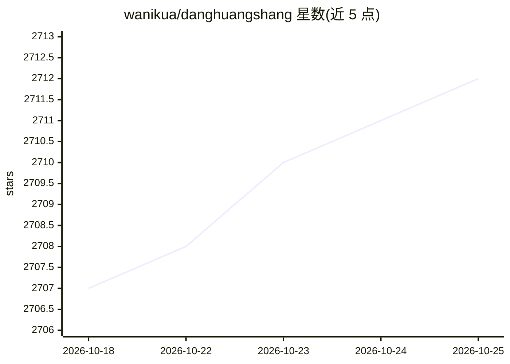

# wanikua/danghuangshang

⭐ 2,712 · TypeScript · MIT · 推送 2026-05-22 · [GitHub](https://github.com/wanikua/danghuangshang) · [官网](https://danghuangshang.com) · 个人维护 · 中文 README

**仿明朝官制的多 Agent 协作系统，用 Discord/飞书指挥 AI 大臣**

基于 OpenClaw 框架的多 Agent 协作模板：把用户指令映射为朝廷流程——司礼监接旨、内阁做 Prompt 增强、六部（编码/财务/营销/运维/项目/法务）分工执行、都察院在 GitHub push 时自动代码审查。提供明朝内阁制（18 Agent）、唐朝三省制、现代企业制三种配置，含翰林院小说创作流水线、60+ Skill、独立记忆与备份脚本、React Web Dashboard，另支持 Hermes Agent runtime 并存。通过安装脚本部署，接入 Discord/飞书等平台，需自备 LLM API Key 与 Bot Token。

## 筛选速览

| 维度 | 判定 | 备注 |
|---|---|---|
| AI 角色 | `ai-native` | 本体是模型或模型工具 |
| 许可风险 | `permissive` | MIT |
| 部署形态 | `self-host` | docker 或自建部署 |
| 模型依赖 | — | README 未给出锁定关系 |
| 硬件要求 | — | 无带数字的原话,不猜 |
| 安装摩擦 | `low` | 无编译、无系统依赖或容器化 |
| 成熟度 | — | 结构信号不足 |

## 能力要点

- 三种制度模板：明朝内阁制 18 Agent / 唐朝三省制 / 现代企业制
- 内阁 Prompt 前置优化 + 都察院 GitHub push 自动代码审查
- 60+ Skill（GitHub/Notion/浏览器/Cron/TTS 等）与每 Agent 独立记忆
- 一键安装脚本、Docker 镜像（amd64/arm64）、React Web Dashboard

## 适用场景

- 在 Discord/飞书里用自然语言指挥一组分工的 AI Agent 干活
- 自动写日报周报、定时任务、代码备份等 7×24 运维
- 搭建多 Agent 协作写小说的流水线（翰林院）

## 场景标签

`多智能体` `Agent 框架` · 领域:Agent 开发

## 证据(README 行号)

> L25: > **以明朝内阁制为蓝本，用 OpenClaw 框架构建的多 Agent 协作系统。**
> L65: **AI 朝廷**是一个开箱即用的多 Agent 协作系统。你是皇帝，AI 是你的大臣。在 Discord 或飞书 @某个 Agent，大臣们就会立刻执行。司礼监接旨、内阁优化 Prompt、六部各司其职、都察院自动审查代码。**
> L488: **核心优势：不是框架，是成品。** 跑个脚本就能用，在 Discord 里 @谁谁回复。

## 星数曲线

2026-10-18 2,707 → 2026-10-25 2,712（+5）

---
*卡片 v1 · prompt 1.4 · 生成 2026-10-21 · 置信度 mid · 依据 README sha `e966b66c7d60` · [字段定义](../../DATASET.md)*
