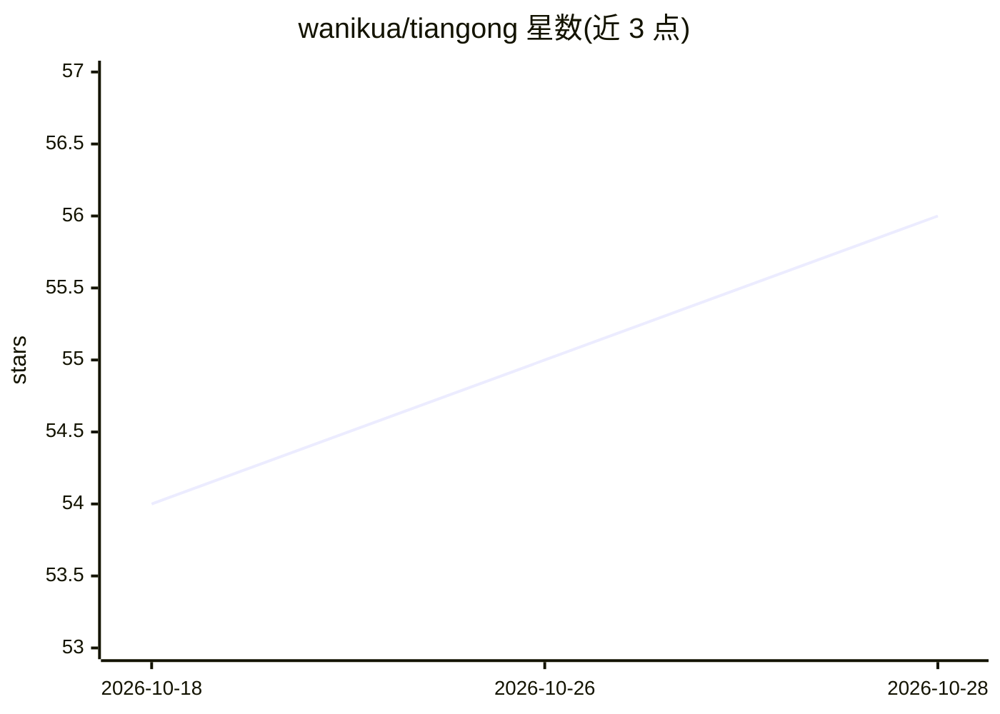

# wanikua/tiangong

⭐ 56 · JavaScript · NOASSERTION · 推送 2026-04-07 · [GitHub](https://github.com/wanikua/tiangong) · [官网](https://danghuangshang.com) · 个人维护 · 中文 README

**模拟中国古代朝廷制度的多 Agent 编程框架 CLI**

将中国明清/唐制官僚体系映射到 AI Agent 架构：Agent 按决策、审核、执行层组织，提供明朝内阁制、唐朝三省制、现代企业制三种治理结构可运行时热切换。核心机制包括 Agent 自动重写自身 Prompt 的自进化、L0/L1/L2 分层上下文加载（OpenViking 范式）、Agent 对决/廷议/科举考核、MBTI×星座性格档案。以 Node.js CLI 提供，支持 Anthropic/OpenRouter/OpenAI/DeepSeek/Qwen/Ollama/LM Studio 等多种 Provider。License 为 BSL 1.1，非商用免费，2030 年后转 Apache 2.0。

## 筛选速览

| 维度 | 判定 | 备注 |
|---|---|---|
| AI 角色 | `ai-ecosystem` | LLM/agent 周边工具 |
| 许可风险 | `none` | NOASSERTION |
| 部署形态 | `library` | 以包/库形式分发 |
| 模型依赖 | local-ok | 支持本地模型 |
| 硬件要求 | — | 无带数字的原话,不猜 |
| 安装摩擦 | `low` | 无编译、无系统依赖或容器化 |
| 成熟度 | — | 结构信号不足 |

## 能力要点

- 三种治理制度（明朝内阁/唐朝三省/现代企业制）可运行时切换
- Agent 自进化：根据表现数据自动重写自身 Prompt
- L0/L1/L2 三层上下文按需加载（viking:// 文件系统范式）
- Agent 对决、廷议辩论、科举考试等多 Agent 竞争与考核机制

## 适用场景

- 通过多 Agent 分工协作完成编码任务
- 让多个 Agent 就技术方案辩论并总结共识
- 无需 API Key 用 Ollama 本地模型运行多 Agent 工作流

## 场景标签

`多智能体` `编码 Agent` `Agent 框架` · 领域:Agent 开发

## 证据(README 行号)

> L15: TianGong is a **self-evolving multi-agent AI framework** that maps China's ancient imperial bureaucracy onto AI age
> L3: ### An AI Agent Framework Inspired by Ancient Chinese Governance | 三省六部制 AI Agent 框架
> L98: |Provider|Models|Local?|

## 星数曲线

2026-10-18 54 → 2026-10-28 56（+2）

---
*卡片 v1 · prompt 1.4 · 生成 2026-10-24 · 置信度 high · 依据 README sha `e19b1e2bffa4` · [字段定义](../../DATASET.md)*
