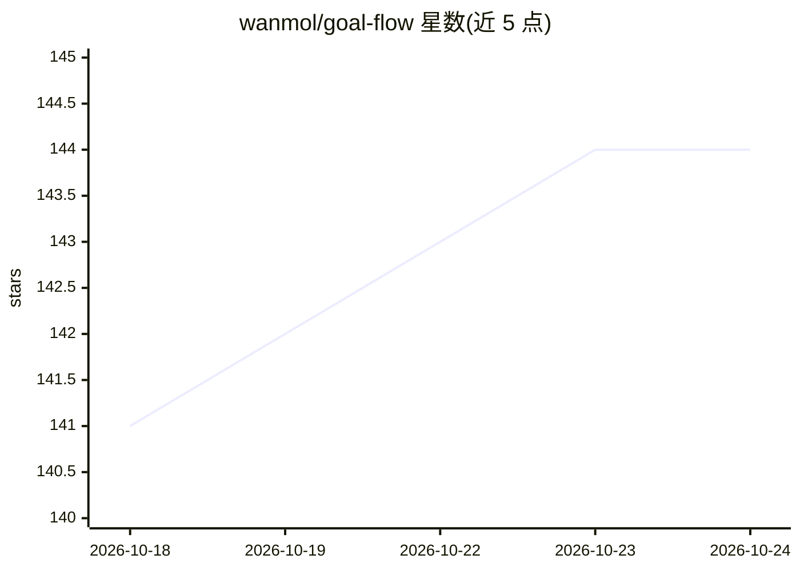

# wanmol/goal-flow

⭐ 144 · Python · MIT · 推送 2026-08-13 · [GitHub](https://github.com/wanmol/goal-flow) · 个人维护 · 中文 README

**基于 LangGraph 的图编排 Agent 循环框架，可转译 Dify DSL**

在 LangGraph 之上构建 LLM 应用的 Python 框架，提供两种构建方式：在 Dify 可视化编辑器中设计流程后用一条命令将导出 DSL 转译为可运行的 LangGraph Python 文件；或用内置的 agent_kit SDK 以代码构建 ReAct/Deep/自定义 agent 循环，含中间件、模型路由、故障转移与可观测性。二者可组合：graph 节点可承载 agent 循环，agent 可将子工作流作为工具调用。支持可插拔传输协议适配器（默认 Dify 协议，附带 OpenAI 兼容）。从内部生产系统抽取，部分默认值偏向阿里云 OSS 与 Qwen/DashScope。运行需 Python 3.12、Redis 与 MySQL；README 含安全警告：git 历史中存在真实凭证，公开发布前须清理。

## 筛选速览

| 维度 | 判定 | 备注 |
|---|---|---|
| AI 角色 | `ai-ecosystem` | LLM/agent 周边工具 |
| 许可风险 | `permissive` | MIT |
| 部署形态 | `None` |  |
| 模型依赖 | — | README 未给出锁定关系 |
| 硬件要求 | — | 无带数字的原话,不猜 |
| 安装摩擦 | `low` | 无编译、无系统依赖或容器化 |
| 成熟度 | — | 结构信号不足 |

## 能力要点

- Dify DSL → LangGraph Python 文件的一键转译器
- 20+ 内置节点库（LLM/代码/HTTP/条件/迭代/agent 等）
- 可插拔 DataAdapter：默认 Dify 协议，附带 OpenAI 兼容协议
- 分支感知的 token 流式输出与 HITL 中断；SKILL.md 技能匹配注入提示词

## 适用场景

- 在 Dify 可视化设计流程后脱离 Dify 运行时自主部署
- 将工作流图与 agent 循环组合构建 LLM 应用
- 接入 Milvus 做知识检索并配合文档摄取 CLI 使用

## 场景标签

`Agent 框架` `RAG` · 领域:Agent 开发

## 证据(README 行号)

> L11: **G**raph-**O**rchestrated **A**gent **L**oop — a production-grade framework for building LLM applications on top o
> L14: - **Code-first agents** — build ReAct / Deep / custom agent loops with the bundled `agent_kit` SDK (vendored under 
> L16: Because plain workflow graphs and plain agent loops each have limits, the framework is designed so you can combine 

## 星数曲线

2026-10-18 141 → 2026-10-24 144（+3）

---
*卡片 v1 · prompt 1.4 · 生成 2026-10-22 · 置信度 high · 依据 README sha `20bd6f01c374` · [字段定义](../../DATASET.md)*
