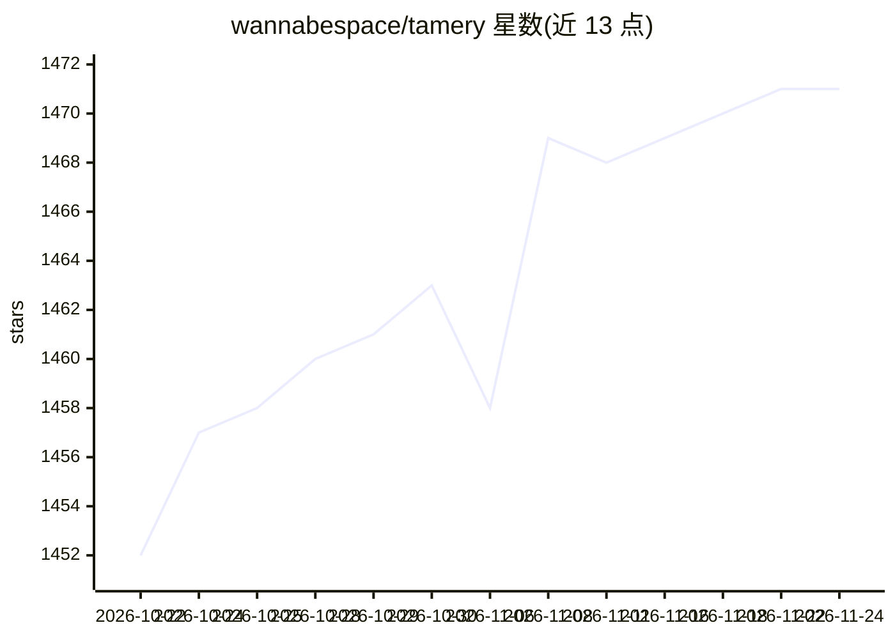

# wannabespace/tamery

⭐ 1,471 · TypeScript · AGPL-3.0 · 推送 2026-11-22 · [GitHub](https://github.com/wannabespace/tamery) · [官网](https://tamery.app) · 组织维护

**面向用户与 AI agent 的多数据库桌面/Web 客户端**

一款数据库客户端，支持 PostgreSQL、MySQL、MariaDB、SQL Server、Oracle、ClickHouse、MongoDB、SQLite、DuckDB 等多种数据库，提供表格浏览与单元格编辑、带 schema 感知自动补全的查询编辑器、schema 可视化、SSH 隧道与 SSL、跨设备连接同步。AI 方面内置可编写、解释、修复 SQL 的助手，并以 MCP server 形式让 Claude Code、Cursor 等 agent 查询数据库，所有写操作需用户点击确认。桌面版可离线使用，无账号可跳过登录。

## 筛选速览

| 维度 | 判定 | 备注 |
|---|---|---|
| AI 角色 | `ai-enhanced` | 去掉 AI 部分产品仍成立 |
| 许可风险 | `viral` | AGPL-3.0 |
| 部署形态 | `library` | 以包/库形式分发 |
| 模型依赖 | — | README 未给出锁定关系 |
| 硬件要求 | — | 无带数字的原话,不猜 |
| 安装摩擦 | `low` | 无编译、无系统依赖或容器化 |
| 成熟度 | — | 结构信号不足 |

## 能力要点

- 内置 AI 助手编写、解释和修复 SQL，写数据前需确认
- MCP server 让 Claude Code、Cursor 等 agent 查询数据库，写操作等待用户点击
- 支持连接串、.env、JDBC URL、psql 命令的自动识别
- 连接串始终加密，Metadata only 模式下不出本机

## 适用场景

- 用一个客户端管理多种数据库的表浏览与查询
- 让 AI agent 通过 MCP 受控查询生产数据库
- 通过对话生成和修复 SQL 查询
- 本地离线环境下的数据库连接管理

## 场景标签

`数据分析` · 领域:效率与自动化

## 证据(README 行号)

> L3: _The AI-powered database client and MCP server for desktop and web_
> L41: - MCP server. Claude Code, Cursor and other agents can query your databases. Every write waits for your click.
> L48: - Everyday features are free. Pro adds the full AI assistant.

## 星数曲线

2026-10-22 1,452 → 2026-11-24 1,471（+19）

---
*卡片 v1 · prompt 1.4 · 生成 2026-11-23 · 置信度 mid · 依据 README sha `b0fa006da620` · [字段定义](../../DATASET.md)*
