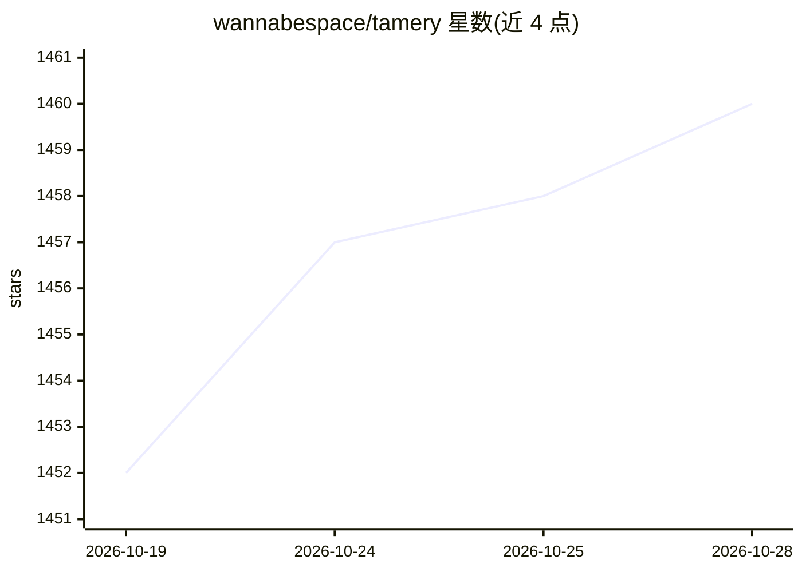

# wannabespace/tamery

⭐ 1,460 · TypeScript · AGPL-3.0 · 推送 2026-10-27 · [GitHub](https://github.com/wannabespace/tamery) · [官网](https://tamery.app) · 组织维护

**面向用户与 AI agent 的桌面/网页数据库客户端**

支持 PostgreSQL、MySQL、MariaDB、SQL Server、ClickHouse 与 SQLite（含 Turso、Cloudflare D1）的数据库客户端，提供表浏览与单元格编辑、感知 schema 的查询编辑器、schema 可视化、SSH 隧道与 SSL、跨设备连接同步。AI 部分：可编写/解释/修复 SQL 的 AI 助手（Pro 功能），及内置 MCP server 供 Claude Code、Cursor 等 agent 查询数据库，写入操作需用户点击确认。可下载桌面应用或用 pnpm/Bun/Docker 自行运行，不接受 PR。

## 筛选速览

| 维度 | 判定 | 备注 |
|---|---|---|
| AI 角色 | `ai-enhanced` | 去掉 AI 部分产品仍成立 |
| 许可风险 | `viral` | AGPL-3.0 |
| 部署形态 | `library` | 以包/库形式分发 |
| 模型依赖 | — | README 未给出锁定关系 |
| 硬件要求 | — | 无带数字的原话,不猜 |
| 安装摩擦 | `low` | 无编译、无系统依赖或容器化 |
| 成熟度 | — | 结构信号不足 |

## 能力要点

- 支持 PostgreSQL/MySQL/MariaDB/MSSQL/ClickHouse/SQLite（含 Turso、D1）
- AI 助手编写/解释/修复 SQL，改动数据前须确认
- 内置 MCP server，Claude Code/Cursor 等 agent 可查询数据库
- 连接字符串加密，Metadata only 模式下不出本机

## 适用场景

- 我需要一个能可视化浏览表和编辑数据的数据库客户端
- 让 Claude Code 或 Cursor 直接查询我的数据库
- 在本地安全保存连接串并跨设备同步连接

## 场景标签

 · 领域:数据库工具

## 证据(README 行号)

> L3: _The AI-powered database client and MCP server for desktop and web_
> L35: - AI assistant that writes, explains and fixes SQL. It never changes data without asking.
> L39: - MCP server. Claude Code, Cursor and other agents can query your databases. Every write waits for your click.

## 星数曲线

2026-10-19 1,452 → 2026-10-28 1,460（+8）

---
*卡片 v1 · prompt 1.4 · 生成 2026-10-21 · 置信度 mid · 依据 README sha `45968634b1bf` · [字段定义](../../DATASET.md)*
