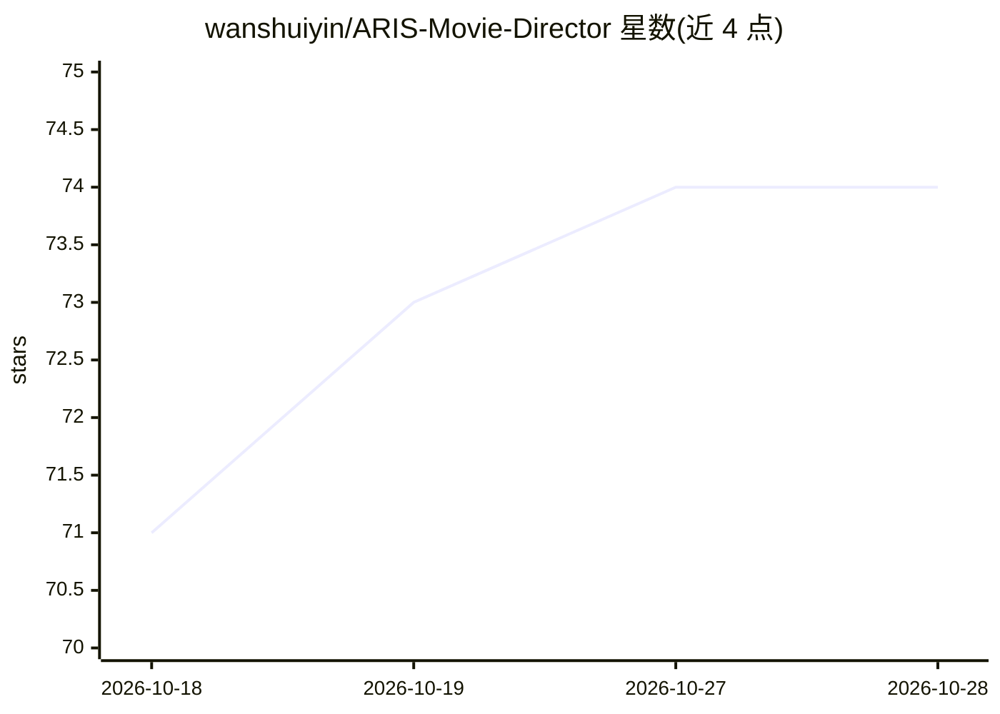

# wanshuiyin/ARIS-Movie-Director

⭐ 74 · Python · MIT · 推送 2026-10-17 · [GitHub](https://github.com/wanshuiyin/ARIS-Movie-Director) · [官网](https://wanshuiyin.github.io/ARIS-Movie-Director/comic/) · 个人维护 · 中文 README

**模糊故事经多智能体审计生成交叉模型校验的图像电影**

面向使用编码智能体的开发者的长程视觉生成工作流：输入模糊故事，先由 comic-author 生成确定性 comic.json（锁定 expected_literals 与身份参考），再由扩散模型烘焙画面，每帧经独立跨模型盲转录（Gemini 视觉 ‖ Codex 视觉 ‖ 叙事审阅）加确定性 token-diff 决定 KEEP/RETRY，所有尝试与决策写入 research-wiki。以 skills/ 形式由编码智能体驱动，需智能体运行时与外部模型 CLI；当前版本仅支持图像，视频为后续计划。提供在线托管示例。

## 筛选速览

| 维度 | 判定 | 备注 |
|---|---|---|
| AI 角色 | `ai-native` | 本体是模型或模型工具 |
| 许可风险 | `permissive` | MIT |
| 部署形态 | `library` | 以包/库形式分发 |
| 模型依赖 | — | README 未给出锁定关系 |
| 硬件要求 | — | 无带数字的原话,不猜 |
| 安装摩擦 | `low` | 无编译、无系统依赖或容器化 |
| 成熟度 | `idea` | |

## 能力要点

- 先锁定 expected_literals 再生成像素，确定性 token-diff 拒绝含错误文字的画面
- 跨模型盲转录审阅与单票否决，生成模型不得自我签收
- 全流程尝试/审阅/决策写入 research-wiki（参考运行含 198 节点轨迹）
- 两条工作流：/movie-pipeline 生成电影，/method-figure 生成经审计的方法图

## 适用场景

- 把一个模糊故事交给智能体，生成事实经过审计的图像电影
- 生成含精确文字/数字且可验证不漂移的连环画式内容
- 追踪长序列生成中每一帧的审阅与失败记录

## 场景标签

`多智能体` `图像生成` · 领域:Agent 开发

## 证据(README 行号)

> L15: **This is an agentic, long-horizon visual generation task:** hand a fuzzy story to an agent and produce a whole
> L30: **(2)** `comic-director` runs the per-panel audited spiral — the **multi-agent
> L42: > **(1) Authored source of truth** — asset library · outline · storyboard compile into `comic.json` (`content_svg ·

## 星数曲线

2026-10-18 71 → 2026-10-28 74（+3）

---
*卡片 v1 · prompt 1.4 · 生成 2026-10-24 · 置信度 mid · 依据 README sha `4ef859badc08` · [字段定义](../../DATASET.md)*
