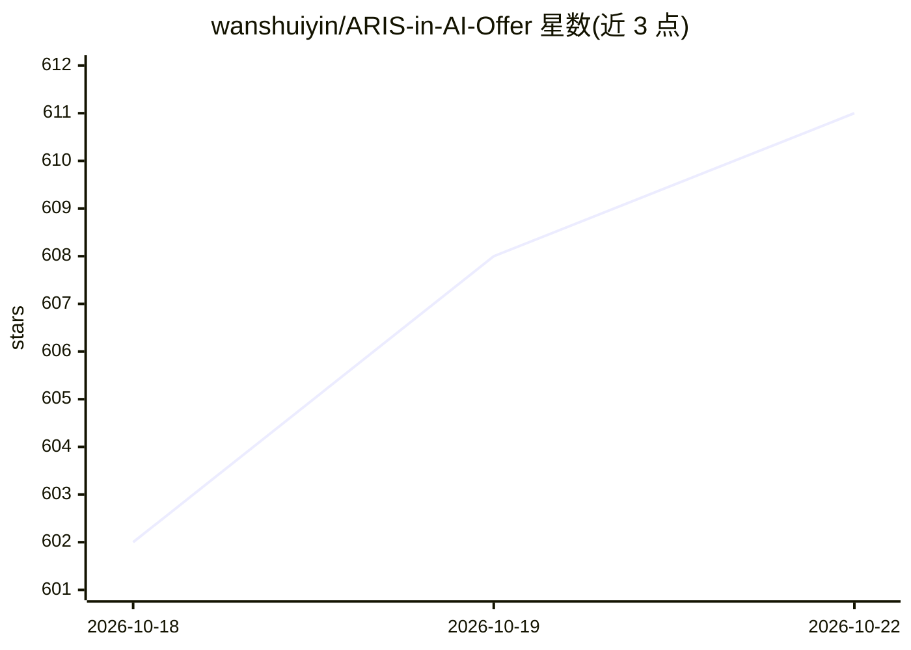

# wanshuiyin/ARIS-in-AI-Offer

⭐ 611 · Python · MIT · 推送 2026-10-17 · [GitHub](https://github.com/wanshuiyin/ARIS-in-AI-Offer) · 个人维护 · 中文 README

**AI 秋招双语面试速查表合集（35 篇，8 类）**

面向中文 AI 校招（秋招）求职者的双语（中文+英文）面试速查表集合：35 篇第一方速查表覆盖 ML/LLM/扩散模型/多模态/Agent/具身智能等 8 类主题，每篇含公式推导、可运行 PyTorch 代码与 25 道分层（L1/L2/L3）高频面试题，另有社区贡献题库。内容由 ARIS（Auto Research in Sleep）的 /interview-cheatsheet + /render-html 工作流生成，经多轮跨模型评审；单文件 HTML 可离线阅读，MathJax 渲染公式。附赠 CV→学术主页生成器与长篇技术综述博客。

## 筛选速览

| 维度 | 判定 | 备注 |
|---|---|---|
| AI 角色 | `ai-knowledge` | 知识聚合/清单类 |
| 许可风险 | `permissive` | MIT |
| 部署形态 | `library` | 以包/库形式分发 |
| 模型依赖 | — | README 未给出锁定关系 |
| 硬件要求 | — | 无带数字的原话,不猜 |
| 安装摩擦 | `low` | 无编译、无系统依赖或容器化 |
| 成熟度 | — | 结构信号不足 |

## 能力要点

- 35 篇双语速查表覆盖 8 大类主题，每篇 25 道分层高频题
- 三栏结构：公式推导 + 面试问答 + 可运行的 from-scratch PyTorch 代码
- 单文件 HTML：MathJax 公式可复制、响应式布局、粘性目录、可离线阅读
- 由 ARIS /interview-cheatsheet + /render-html 工作流生成并经多轮跨模型评审

## 适用场景

- 秋招前在手机/平板上快速复习 ML/LLM/扩散模型面试考点
- 按 L1/L2/L3 难度分级练习高频面试题
- 通过可运行 PyTorch 代码理解底层实现（如 DDIM 采样、AdamW 推导）

## 场景标签

 · 领域:AI 求职教育/知识聚合

## 证据(README 行号)

> L21: A curated, **bilingual** (中文 + English) collection of ML / LLM / multimodal / diffusion / agent / generative-model 
> L23: Each cheat sheet is a long-form Chinese tutorial with: formula derivations · from-scratch PyTorch code · 25 high-fr
> L11: **📚 Jump to a topic** — 35 first-party cheat sheets across 8 categories, plus a community-contributed question bank

## 星数曲线

2026-10-18 602 → 2026-10-22 611（+9）

---
*卡片 v1 · prompt 1.4 · 生成 2026-10-21 · 置信度 mid · 依据 README sha `139485539664` · [字段定义](../../DATASET.md)*
