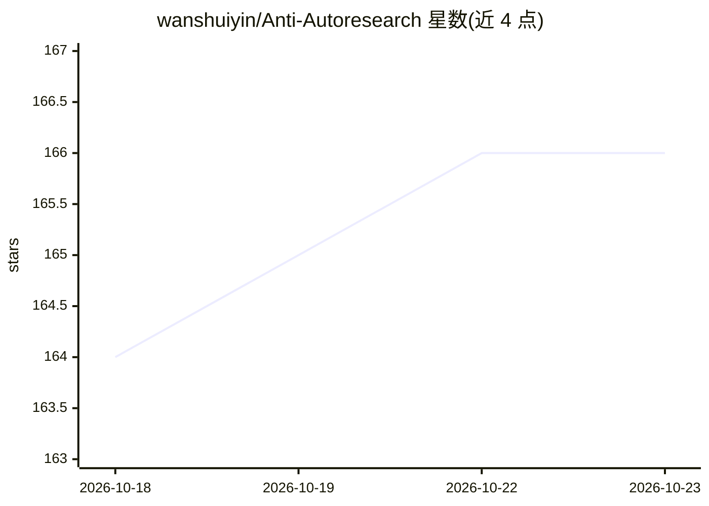

# wanshuiyin/Anti-Autoresearch

⭐ 166 · Python · MIT · 推送 2026-10-17 · [GitHub](https://github.com/wanshuiyin/Anti-Autoresearch) · 个人维护 · 中文 README

**审稿人侧的论文诚信取证工具：审计自洽性与编造并出确定性裁决**

面向审稿人、领域主席与作者的论文诚信取证工作流：以 Claude Code skill 形式运行，先构建 span 锚定、带哈希的证据台账，再由 LLM 审计器（11 个 skill + 1 个编排工作流）提出发现，最终由纯规则裁决器生成报告与裁决，模型不参与打分。覆盖 8 大类 46 种诚信问题模式（数值自洽、基线、引用、实验、证明、评测设计等），另有 13 项零权重 AI 文风印象与 2 项 advisory。不做 AI 文本分类器、不判学术不端。8 种模式经确定性 eval 门控并接入 CI；PDF-only 运行的可观测性受限。

## 筛选速览

| 维度 | 判定 | 备注 |
|---|---|---|
| AI 角色 | `ai-native` | 本体是模型或模型工具 |
| 许可风险 | `permissive` | MIT |
| 部署形态 | `None` |  |
| 模型依赖 | — | README 未给出锁定关系 |
| 硬件要求 | — | 无带数字的原话,不猜 |
| 安装摩擦 | `low` | 无编译、无系统依赖或容器化 |
| 成熟度 | `idea` | |

## 能力要点

- 8 大类 46 种诚信模式 + 13 项零权重 AI 文风印象 + 2 项 advisory
- LLM 审计器只提议发现，纯规则裁决器产出最终裁决
- 7 个独立审计 skill（一致性/引用/基线/实验/证明/评测设计/表面信号）
- 确定性核心仅依赖 Python 3 标准库，eval 回归门控接入 CI

## 适用场景

- 审稿或领域主席处理疑似机器生成论文时核验其自洽性与证据支撑
- 作者在投稿前自查数值、基线与引用的诚信问题
- 在 CI 中跑确定性检查做回归验证

## 场景标签

 · 领域:科研工具/学术诚信

## 证据(README 行号)

> L18: > reflect its own evidence? Anti-Autoresearch audits a submission for
> L19: > **self-consistency** and **fabrication**, and produces a span-anchored,
> L41: Delivered as **11 skills + 1 orchestrating workflow** on a deterministic spine: a span-anchored, hashed evidence **

## 星数曲线

2026-10-18 164 → 2026-10-23 166（+2）

---
*卡片 v1 · prompt 1.4 · 生成 2026-10-22 · 置信度 high · 依据 README sha `df500d26983b` · [字段定义](../../DATASET.md)*
