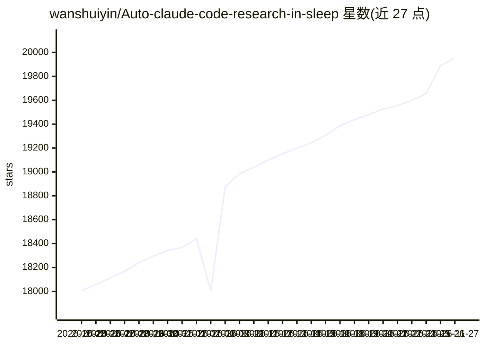

# wanshuiyin/Auto-claude-code-research-in-sleep

⭐ 19,953 · Python · MIT · 推送 2026-11-26 · [GitHub](https://github.com/wanshuiyin/Auto-claude-code-research-in-sleep) · 个人维护 · 中文 README

**以 Markdown 技能承载的自主 ML 研究工作流，挂载到任意 LLM agent**

ARIS 提供一组纯 Markdown 技能文件，实现自主机器学习研究工作流：跨模型评审循环、研究想法发现与实验自动化。自称方法论而非平台，无框架依赖，可作为技能装进 Claude Code、Codex CLI、Cursor、OpenClaw 等 agent 运行时；也提供独立 CLI（ARIS-Code）与插件形态。执行 agent 驱动，默认由独立的 Codex MCP 模型充当评审；另有 SuperARIS 多 agent 团队形态，项目文件跨会话保留记忆。

## 筛选速览

| 维度 | 判定 | 备注 |
|---|---|---|
| AI 角色 | `ai-ecosystem` | LLM/agent 周边工具 |
| 许可风险 | `permissive` | MIT |
| 部署形态 | `desktop` | 安装包/桌面程序 |
| 模型依赖 | local-ok | 支持本地模型 |
| 硬件要求 | — | 无带数字的原话,不猜 |
| 安装摩擦 | `low` | 无编译、无系统依赖或容器化 |
| 成熟度 | — | 结构信号不足 |

## 动量与使用信号

- 维护:`active` — 距上次 push 1.0 天,年发版 46,84 位贡献者
- 涨星:近 1 天 **+62**(自 20261016 起算)
- 安装:npm 包 `@google/gemini-cli` 月下载 1,647,448
- 平台:WINDOWS / MACOS · 协议:OPENAI-API / MCP / OLLAMA

## 能力要点

- 纯 Markdown 技能文件，无框架依赖，可在多个 agent CLI 中复用
- 跨模型评审循环：执行者驱动、独立模型评审，默认 Codex MCP
- 随附 ARIS-Code 独立 CLI 与 Claude Code/Codex/DeepSeek Harness 插件
- SuperARIS：主 agent 协调工程与写作并行，项目文件跨会话承载记忆

## 适用场景

- 在 Claude Code/Codex 等环境中自动跑通从想法到实验的研究流程
- 让一个独立模型交叉评审另一个模型产出的实验与写作
- 用多 agent 团队并行推进工程实现与论文写作

## 场景标签

`多智能体` `科研工具` · 领域:Agent 开发

## 证据(README 行号)

> L9: 🌱 *ARIS is a methodology, not a platform. What matters is the research workflow — take it wherever you go.*
> L11: 💡 *Use ARIS as a skill-based workflow in Claude Code / Codex CLI / Cursor / Trae / Antigravity / GitHub Copilot CLI
> L13: 📦 *Those are the skills installed directly. Want it in one command? ARIS also ships as a standalone CLI and as plug

## 星数曲线

2026-10-25 18,005 → 2026-11-27 19,953（+1,948）

---
*卡片 v1 · prompt 1.4 · 生成 2026-11-26 · 置信度 mid · 依据 README sha `1ee5c13afacf` · [字段定义](../../DATASET.md)*
