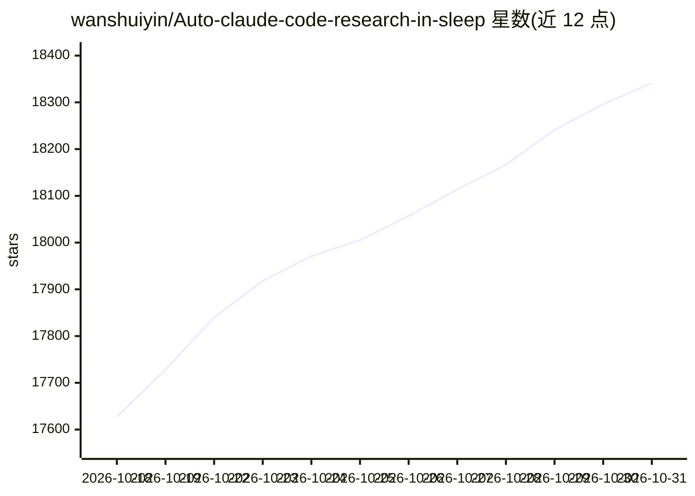

# wanshuiyin/Auto-claude-code-research-in-sleep

⭐ 18,341 · Python · MIT · 推送 2026-10-30 · [GitHub](https://github.com/wanshuiyin/Auto-claude-code-research-in-sleep) · 个人维护 · 中文 README

**面向 LLM agent 的自主 ML 研究技能集：交叉评审、想法发现、实验自动化**

ARIS 是一套 Markdown 技能包，定义自动化机器学习研究的工作流：执行模型驱动研究，独立模型（默认 Codex MCP）负责评审，形成跨模型评审循环；包含 82 个技能，覆盖想法发现与实验自动化。可装入 Claude Code、Codex CLI、Cursor、OpenClaw 等任意 LLM agent 框架，无需绑定特定平台；另有 ARIS-Code CLI 独立安装版与各框架插件。codex-cli 0.154 移除 codex mcp-server 后改用自带 codex exec 桥接。

## 筛选速览

| 维度 | 判定 | 备注 |
|---|---|---|
| AI 角色 | `ai-ecosystem` | LLM/agent 周边工具 |
| 许可风险 | `permissive` | MIT |
| 部署形态 | `desktop` | 安装包/桌面程序 |
| 模型依赖 | local-ok | 支持本地模型 |
| 硬件要求 | — | 无带数字的原话,不猜 |
| 安装摩擦 | `low` | 无编译、无系统依赖或容器化 |
| 成熟度 | — | 结构信号不足 |

## 动量与使用信号

- 维护:`active` — 距上次 push 1.0 天,年发版 46,84 位贡献者
- 涨星:近 1 天 **+62**(自 20261016 起算)
- 安装:npm 包 `@google/gemini-cli` 月下载 1,647,448
- 平台:WINDOWS / MACOS · 协议:OPENAI-API / MCP / OLLAMA

## 能力要点

- 执行模型驱动、独立模型评审的跨模型评审循环
- 82 个 Markdown 技能，无框架绑定，兼容多种 LLM agent CLI
- 提供 ARIS-Code CLI 独立版与 Claude Code / Codex 等插件
- codex exec 桥接替代被移除的 codex mcp-server 入口

## 适用场景

- 让 Claude Code / Codex 等 agent 在无人值守下跑 ML 研究循环
- 用独立评审模型把关 agent 产出的想法与实验代码
- 以技能形式为任意 agent 框架加装研究工作流

## 场景标签

`科研工具` · 领域:学习与行业

## 证据(README 行号)

> L9: 🌱 *ARIS is a methodology, not a platform. What matters is the research workflow — take it wherever you go.*
> L11: 💡 *Use ARIS as a skill-based workflow in Claude Code / Codex CLI / Cursor / Trae / Antigravity / GitHub Copilot CLI
> L13: 📦 *Those are the skills installed directly. Want it in one command? ARIS also ships as a standalone CLI and as plug

## 星数曲线

2026-10-18 17,627 → 2026-10-31 18,341（+714）

---
*卡片 v1 · prompt 1.4 · 生成 2026-10-20 · 置信度 low · 依据 README sha `242808e684c4` · [字段定义](../../DATASET.md)*
