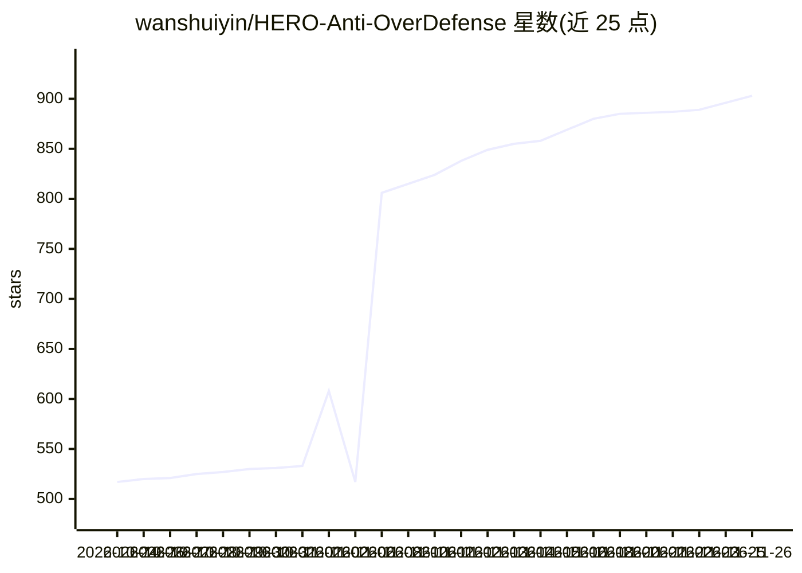

# wanshuiyin/HERO-Anti-OverDefense

⭐ 903 · Python · MIT · 推送 2026-11-18 · [GitHub](https://github.com/wanshuiyin/HERO-Anti-OverDefense) · 个人维护 · 中文 README

**一段粘贴进配置文件的契约，抑制编码代理的过度防御行为**

一个可粘贴到编码代理配置文件（CLAUDE.md、AGENTS.md、copilot-instructions.md、.cursorrules 等）的规则块，将代理的过度防御归纳为 Hashing、Edge cases、Rubrics、Overbuild 四类，并以九条范围规则约束其提案行为。配套 cases/ 行为目录供用户按 ID 引用反驳、Goal Pulse 30 分钟 Python 定时提醒（Claude Code 用原生 /loop）、Session Handoff 会话交接 Markdown 技能。MIT 许可，README 提供中英文双语版本与短版规则块。

## 筛选速览

| 维度 | 判定 | 备注 |
|---|---|---|
| AI 角色 | `ai-ecosystem` | LLM/agent 周边工具 |
| 许可风险 | `permissive` | MIT |
| 部署形态 | `None` |  |
| 模型依赖 | — | README 未给出锁定关系 |
| 硬件要求 | — | 无带数字的原话,不猜 |
| 安装摩擦 | `low` | 无编译、无系统依赖或容器化 |
| 成熟度 | — | 结构信号不足 |

## 能力要点

- HERO 四类过度防御分类法：Hashing/Edge cases/Rubrics/Overbuild
- 支持 7 种编码代理宿主的粘贴式配置块，附加式写入且幂等
- Goal Pulse 每 30 分钟双语执行提醒（Codex 定时器/Claude Code 原生 /loop）
- Session Handoff 基于文件的任务交接工作流，无需 Python

## 适用场景

- 编码代理总写哈希、边界检查等没人读的防御代码时收敛其范围
- 长时无人值守运行中维持代理推进目标的动力
- 新开会话时把任务证据与下一步交接给下个会话

## 场景标签

`提示工程` · 领域:Agent 开发

## 证据(README 行号)

> L22: This repository is a short block you paste into your agent's config, plus a
> L23: catalogue of the behaviours it is meant to stop. It works with **Claude Code**,
> L25: **Gemini CLI** — anything that loads a config file without being asked. There is

## 星数曲线

2026-10-24 517 → 2026-11-26 903（+386）

---
*卡片 v1 · prompt 1.4 · 生成 2026-11-24 · 置信度 high · 依据 README sha `d9edd0d9e5cf` · [字段定义](../../DATASET.md)*
