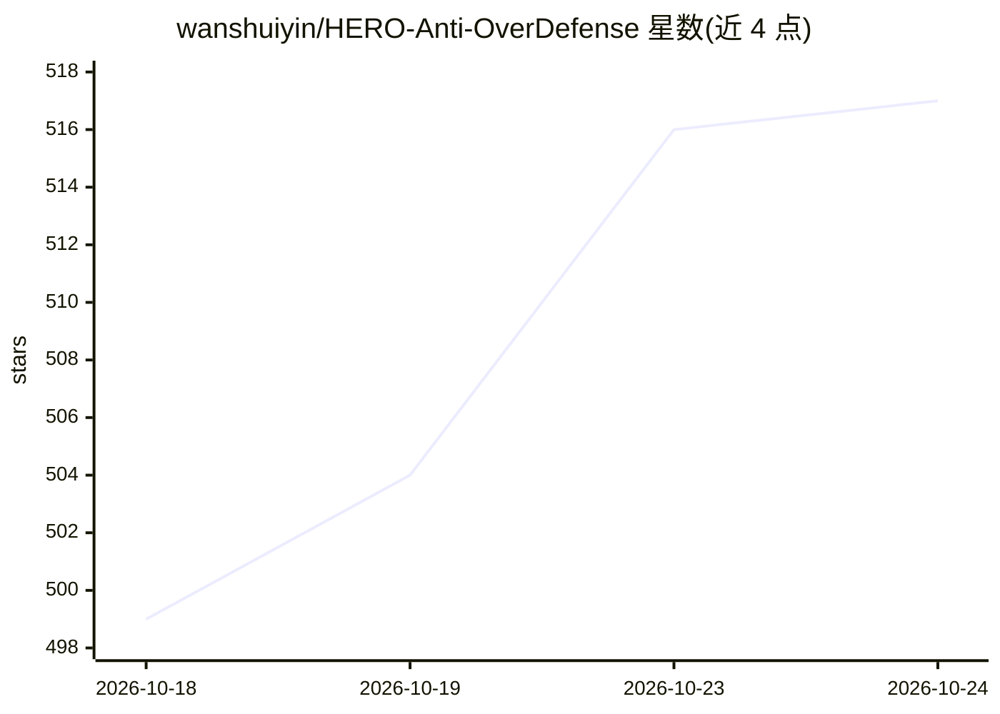

# wanshuiyin/HERO-Anti-OverDefense

⭐ 517 · Markdown · MIT · 推送 2026-10-17 · [GitHub](https://github.com/wanshuiyin/HERO-Anti-OverDefense) · 个人维护 · 中文 README

**抑制编码 Agent 过度防御的粘贴式规则契约**

面向使用 Claude Code、Codex、Cursor、Copilot 等 AI 编码代理的开发者：将一段规则块粘贴进 CLAUDE.md/AGENTS.md 等配置文件，约束 Agent 的四类过度防御行为（无意义哈希、臆造边界情况、机械评分表、过度建设），规则为可被更强指令覆盖的自然语言约束而非强制机制。仓库另含行为案例目录（不粘贴、供人工引用）与各宿主粘贴位置说明；提供 curl 一键追加命令与精简版，无其他安装配置。

## 筛选速览

| 维度 | 判定 | 备注 |
|---|---|---|
| AI 角色 | `ai-ecosystem` | LLM/agent 周边工具 |
| 许可风险 | `permissive` | MIT |
| 部署形态 | `None` |  |
| 模型依赖 | — | README 未给出锁定关系 |
| 硬件要求 | — | 无带数字的原话,不猜 |
| 安装摩擦 | `low` | 无编译、无系统依赖或容器化 |
| 成熟度 | — | 结构信号不足 |

## 能力要点

- 四类过度防御行为分类：Hashing/Edge cases/Rubrics/Overbuild
- 支持 Claude Code、Codex、Antigravity、Cursor、Copilot、Windsurf、Gemini CLI 七种宿主
- curl 命令一键追加规则块，含防重复执行保护
- 附案例目录 cases/ 供按 ID 引用反驳 Agent 的过度加固主张

## 适用场景

- 我的编码 Agent 总在做没人要求的安全加固和防御性代码
- 长时无人值守任务中 Agent 把工作耗在审计循环而非功能本身
- 统一团队内各成员使用的编码代理的行为边界

## 场景标签

 · 领域:AI 编码代理/提示工程

## 证据(README 行号)

> L22: This repository is a short block you paste into your agent's config, plus a
> L23: catalogue of the behaviours it is meant to stop. It works with **Claude Code**,
> L58: Paste this into the file your agent loads automatically — `CLAUDE.md`,

## 星数曲线

2026-10-18 499 → 2026-10-24 517（+18）

---
*卡片 v1 · prompt 1.4 · 生成 2026-10-22 · 置信度 high · 依据 README sha `6b160e15f2b0` · [字段定义](../../DATASET.md)*
