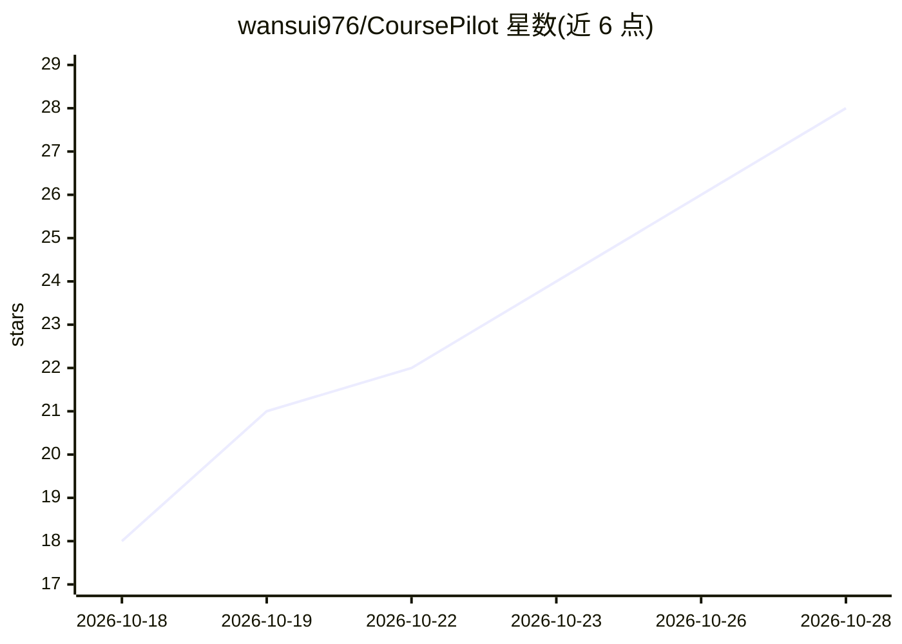

# wansui976/CoursePilot

⭐ 30 · TypeScript · MIT · 推送 2026-10-28 · [GitHub](https://github.com/wansui976/CoursePilot) · [官网](https://wansui976.github.io/CoursePilot/) · 个人维护 · 中文 README

**本地优先的 AI 网课学习工作台：转写、笔记、问答与间隔复习**

面向网课学习者的桌面应用（Tauri + React + Rust）：导入 B 站/YouTube/播客链接或本地视频音频后，自动走「语音识别 → 字幕纠错 → 章节/笔记/练习题/脑图生成」流程；课件按换页自动截取并 OCR，问答回答带时间戳与课件页码，内置 FSRS-4.5 间隔复习。大模型通过用户自填的 OpenAI-compatible API Key 调用（如 DeepSeek），本地 whisper.cpp/tesseract 可完全离线处理。macOS/Windows 提供安装包（内含依赖但未签名），移动端需从源码构建。

## 筛选速览

| 维度 | 判定 | 备注 |
|---|---|---|
| AI 角色 | `ai-native` | 本体是模型或模型工具 |
| 许可风险 | `permissive` | MIT |
| 部署形态 | `desktop` | 安装包/桌面程序 |
| 模型依赖 | — | README 未给出锁定关系 |
| 硬件要求 | — | 无带数字的原话,不猜 |
| 安装摩擦 | `medium` | 含编译或系统依赖之一 |
| 成熟度 | — | 结构信号不足 |

## 能力要点

- 视频自动转写、纠错并生成章节/笔记/脑图/练习题
- 课件自动截取与整批 OCR，问答回答带 [mm:ss] 与课件页码出处
- 内置 FSRS-4.5 间隔复习与学习热力图、薄弱主题分析
- 数据全部本地存储，API Key 存系统钥匙串，可完全离线处理

## 适用场景

- 把 B 站公开课或录屏转成笔记、脑图和练习题来复习
- 对着课程视频提问并跳回原出处确认
- 用间隔复习把长视频课程的内容记住

## 场景标签

`语音识别` `OCR` `知识库管理` `文档问答` · 领域:知识与检索

## 证据(README 行号)

> L7: 开源、本地优先的 AI 网课学习工作台：丢进一节课，拿回字幕、笔记、脑图、课件 OCR、练习题，
> L22: CoursePilot 就是为这个问题而生的。不管是 B 站上的公开课、学校的录屏回放，还是硬盘里囤了好久的培训视频，丢进来就自动走完「转写 → 纠错 → 整理 → 出题」，最后用知识点和间隔复习帮你把它记牢。
> L99: - **一键生成**：章节划分、内容概览、笔记、练习题、脑图，都由大模型根据字幕和课件文字生成，随时可以手动编辑。

## 星数曲线

2026-10-18 18 → 2026-10-28 28（+10）

---
*卡片 v1 · prompt 1.4 · 生成 2026-10-26 · 置信度 mid · 依据 README sha `f954e54b09e2` · [字段定义](../../DATASET.md)*
