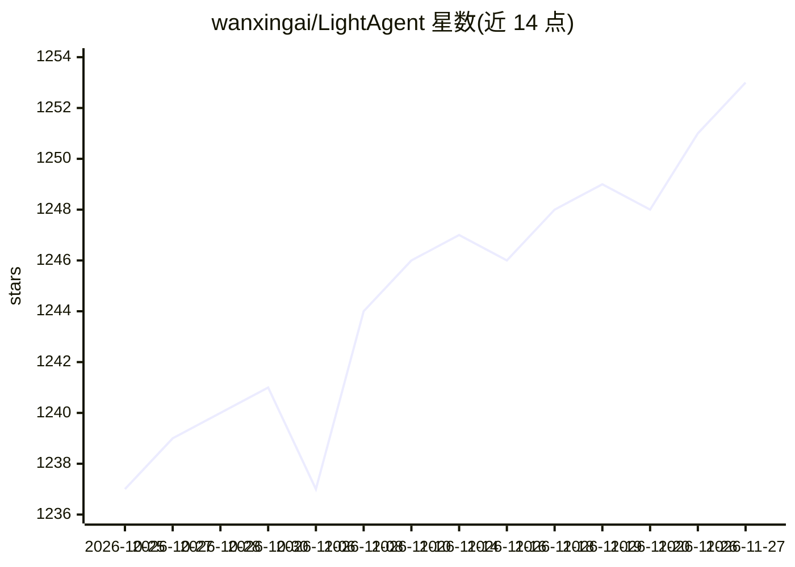

# wanxingai/LightAgent

⭐ 1,253 · Python · Apache-2.0 · 推送 2026-11-15 · [GitHub](https://github.com/wanxingai/LightAgent) · 组织维护 · 中文 README

**轻量 Python Agent 框架：工具、记忆、守护、多代理与工作流编排**

模块化开源 Python 框架，用于构建 OpenAI 兼容模型的智能体：支持自定义工具与 MCP 工具接入、可选长期记忆（原生支持 mem0）、Tree of Thought 反思、LightSwarm 多代理路由、LightFlow 确定性工作流与 LightDAG 动态验证 DAG。可选事件溯源运行时提供持久 Session、回放、审批与恢复；带运行时钩子、Guardrails 模板、追踪导出与确定性评估器。面向需要在 Python 中组装生产级 agent 的开发者。

## 筛选速览

| 维度 | 判定 | 备注 |
|---|---|---|
| AI 角色 | `ai-ecosystem` | LLM/agent 周边工具 |
| 许可风险 | `permissive` | Apache-2.0 |
| 部署形态 | `library` | 以包/库形式分发 |
| 模型依赖 | local-ok | 支持本地模型 |
| 硬件要求 | — | 无带数字的原话,不猜 |
| 安装摩擦 | `low` | 无编译、无系统依赖或容器化 |
| 成熟度 | `idea` | |

## 能力要点

- 工具/记忆/守护/追踪/审批等控制可增量叠加于简化调用路径
- LightSwarm/LightFlow/LightDAG 三种多代理编排模式
- 兼容 OpenAI 风格端点及 OpenRouter、DeepSeek、vLLM、llama.cpp 等提供方
- MCP 支持 stdio、SSE 与 Streamable HTTP 传输

## 适用场景

- 用几行 Python 快速搭建带工具调用与记忆的 agent
- 需要审批、守护与可回放事件的生产级 agent 运行时
- 多代理意图识别与任务委派场景
- 对 agent 输出、工具选择与成本做回归评估

## 场景标签

`Agent 框架` `多智能体` `模型评测` · 领域:Agent 开发

## 证据(README 行号)

> L31: LightAgent is a modular, open-source Python framework with reusable Skills, tools, optional long-term memory, and O
> L55: - **Lightweight and Efficient** 🚀: Minimalist design, quick deployment, suitable for various application scenarios.
> L64: - **Multi-Model Support** 🔄: Compatible with OpenAI-style providers such as OpenAI, OpenRouter, Zhipu ChatGLM, Baic

## 星数曲线

2026-10-25 1,237 → 2026-11-27 1,253（+16）

---
*卡片 v1 · prompt 1.4 · 生成 2026-11-23 · 置信度 high · 依据 README sha `1176fad2aa61` · [字段定义](../../DATASET.md)*
