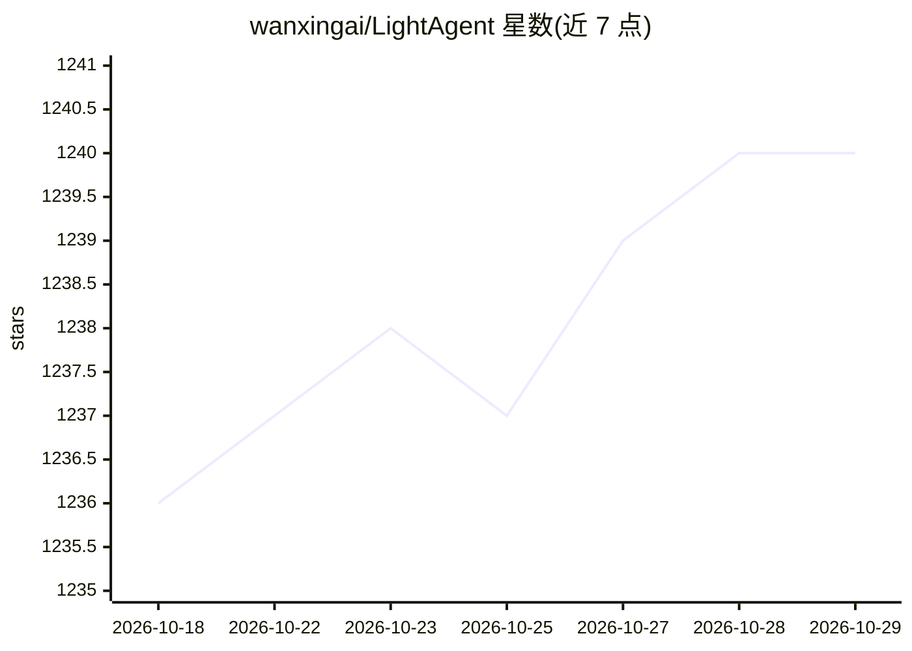

# wanxingai/LightAgent

⭐ 1,240 · Python · Apache-2.0 · 推送 2026-10-28 · [GitHub](https://github.com/wanxingai/LightAgent) · 个人维护 · 中文 README

**轻量级 Python Agent 框架：工具、记忆、护栏、多智能体与工作流**

面向开发者的开源 Agentic 框架，核心 API 为 LightAgent 单智能体运行时，支持工具调用（含 MCP over stdio/SSE）、mem0 长期记忆、思维树推理、护栏模板、运行时钩子与 trace 观测。多智能体层面提供 LightSwarm 意图路由与任务委托、LightFlow 确定性 DAG 工作流（重试、检查点、审批节点）、LightDAG 动态验证 DAG。兼容 OpenAI 风格的多种模型端点（OpenAI、DeepSeek、Qwen、vLLM、llama.cpp 等），可输出 OpenAI 兼容流式 API。不依赖 LangChain/LlamaIndex，以 pip 安装的 Python 库形式提供。

## 筛选速览

| 维度 | 判定 | 备注 |
|---|---|---|
| AI 角色 | `ai-ecosystem` | LLM/agent 周边工具 |
| 许可风险 | `permissive` | Apache-2.0 |
| 部署形态 | `library` | 以包/库形式分发 |
| 模型依赖 | local-ok | 支持本地模型 |
| 硬件要求 | — | 无带数字的原话,不猜 |
| 安装摩擦 | `low` | 无编译、无系统依赖或容器化 |
| 成熟度 | — | 结构信号不足 |

## 能力要点

- LightSwarm 多智能体协作与 LightFlow/LightDAG 确定性与动态工作流编排
- 运行时钩子、trace 观测、LightEvaluator 评估与 HumanApprovalHook 人工审批
- 护栏模板（隐私阻断、敏感工具确认、输出脱敏）与 MemoryPolicy 记忆边界
- 任意 Python 执行工具默认不注册，v0.10.1 起安全默认

## 适用场景

- 快速搭建带工具与长期记忆的单智能体应用
- 编排多智能体协作与多步骤确定性工作流
- 对高影响操作接入人工审批并做回归评估
- 通过 OpenAI 兼容流式 API 对接现有聊天界面

## 场景标签

`Agent 框架` `多智能体` `工作流自动化` `Agent 记忆` · 领域:Agent 开发

## 证据(README 行号)

> L26:  LightAgent🚀 – small footprint, big potential. 🌟(Open-source Agentic framework)
> L58: - **Multi-Model Support** 🔄: Compatible with OpenAI-style providers such as OpenAI, OpenRouter, Zhipu ChatGLM, Baic

## 星数曲线

2026-10-18 1,236 → 2026-10-29 1,240（+4）

---
*卡片 v1 · prompt 1.4 · 生成 2026-10-21 · 置信度 high · 依据 README sha `e0e32de2421d` · [字段定义](../../DATASET.md)*
