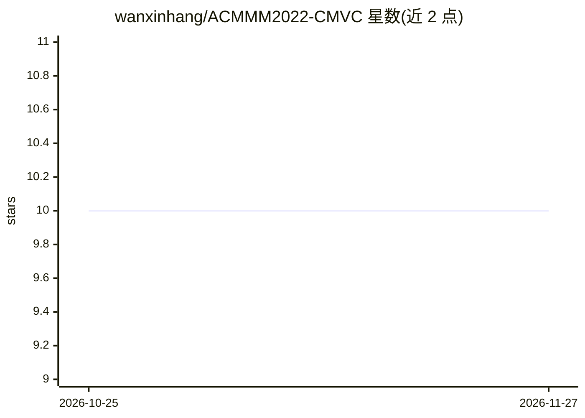

# wanxinhang/ACMMM2022-CMVC

⭐ 10 · MATLAB · 推送 2026-01-31 · [GitHub](https://github.com/wanxinhang/ACMMM2022-CMVC) · 组织维护 · 中文 README

**ACM MM 2022 论文 CMVC（持续多视图聚类）配套代码仓库**

该仓库对应 ACM Multimedia 2022 论文《Continual Multi-View Clustering》，README 提供 BibTeX 引用条目，包含作者、DOI、页码与关键词（late fusion、consensus partition matrix、multi-view clustering、continual learning），并给出作者联系邮箱。README 内容极简，未在可见部分描述安装步骤、运行方式或数据集说明，使用前需联系作者获取更多信息。

## 筛选速览

| 维度 | 判定 | 备注 |
|---|---|---|
| AI 角色 | `ai-knowledge` | 知识聚合/清单类 |
| 许可风险 | `none` | — |
| 部署形态 | `None` |  |
| 模型依赖 | — | README 未给出锁定关系 |
| 硬件要求 | — | 无带数字的原话,不猜 |
| 安装摩擦 | `low` | 无编译、无系统依赖或容器化 |
| 成熟度 | — | 结构信号不足 |

## 能力要点

- 提供 ACM MM 2022 论文的 BibTeX 引用
- DOI 与论文页面链接（doi.org/10.1145/3503161.3547864）
- 作者联系方式（邮箱）

## 适用场景

- 引用该论文时获取标准 BibTeX 条目
- 查找持续多视图聚类方法 CMVC 的配套实现
- 通过邮箱联系作者咨询方法细节

## 场景标签

`科研工具` · 领域:学习与行业

## 证据(README 行号)

> L2: ACM MM 2022 《Continual Multi-view Clustering》
> L16: keywords = {late fusion, consensus partition matrix, multi-view clustering, continual learning},

## 星数曲线

2026-10-25 10 → 2026-11-27 10（+0）

---
*卡片 v1 · prompt 1.4 · 生成 2026-11-19 · 置信度 high · 依据 README sha `903359290ea1` · [字段定义](../../DATASET.md)*
