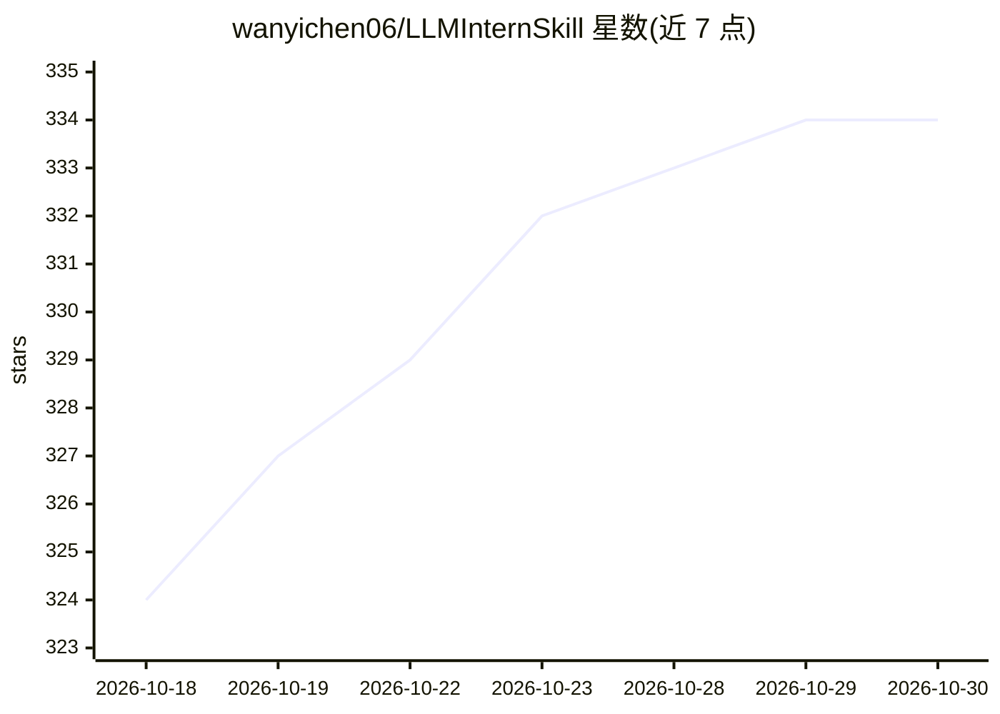

# wanyichen06/LLMInternSkill

⭐ 334 · Markdown · MIT · 推送 2026-08-04 · [GitHub](https://github.com/wanyichen06/LLMInternSkill) · [官网](https://wanyichen06.github.io/LLMInternSkill/) · 个人维护 · 中文 README

**面向大模型实习求职的 Codex Skill 简历工具箱**

一个 evidence-bound 的简历与求职技能包（SKILL.md 形式），供 Codex 等 agent 框架调用：读取原始简历、目标 JD 与 materials/ 材料文件夹，产出简历润色、JD 匹配判定（risky fit 等）、定制简历、逐行诊断、面试追问与回答卡、证据补强计划、开源项目推荐（Project Scout），并用 Bill Ryan 中文 LaTeX 模板生成 PDF-ready 草稿（XeLaTeX 编译）。核心机制是证据边界：把经历判为可写/谨慎写/补证据后写/不能写，拒绝将无证据经历包装成事实。覆盖 RAG、Agent、Post-training、搜索排序等 11 类岗位方向。

## 筛选速览

| 维度 | 判定 | 备注 |
|---|---|---|
| AI 角色 | `ai-native` | 本体是模型或模型工具 |
| 许可风险 | `permissive` | MIT |
| 部署形态 | `None` |  |
| 模型依赖 | — | README 未给出锁定关系 |
| 硬件要求 | — | 无带数字的原话,不猜 |
| 安装摩擦 | `low` | 无编译、无系统依赖或容器化 |
| 成熟度 | — | 结构信号不足 |

## 能力要点

- 证据分级判定：可以写/谨慎写/补证据后写/不能写/无法判断
- JD 匹配分析、定制简历与面试追问（危险/及格/强回答）生成
- Project Scout 推荐开源项目补强证据（含最小运行路径与风险）
- Bill Ryan 中文 LaTeX 模板输出 PDF-ready 简历草稿

## 适用场景

- 准备大模型/AI 实习简历并做逐行诊断润色
- 针对目标 JD 生成定制版简历与匹配度判定
- 面试前生成追问链与分级回答卡
- 材料不足时获得可补证据的开源项目建议

## 场景标签

`AI 写作` · 领域:内容生成

## 证据(README 行号)

> L7:  一个面向大模型实习、AI 求职和 Codex Skill 工作流的 evidence-bound resume toolkit：不只是把简历写好听，而是让每一行都能扛住面试追问。

## 星数曲线

2026-10-18 324 → 2026-10-30 334（+10）

---
*卡片 v1 · prompt 1.4 · 生成 2026-10-21 · 置信度 high · 依据 README sha `62918fcfd302` · [字段定义](../../DATASET.md)*
