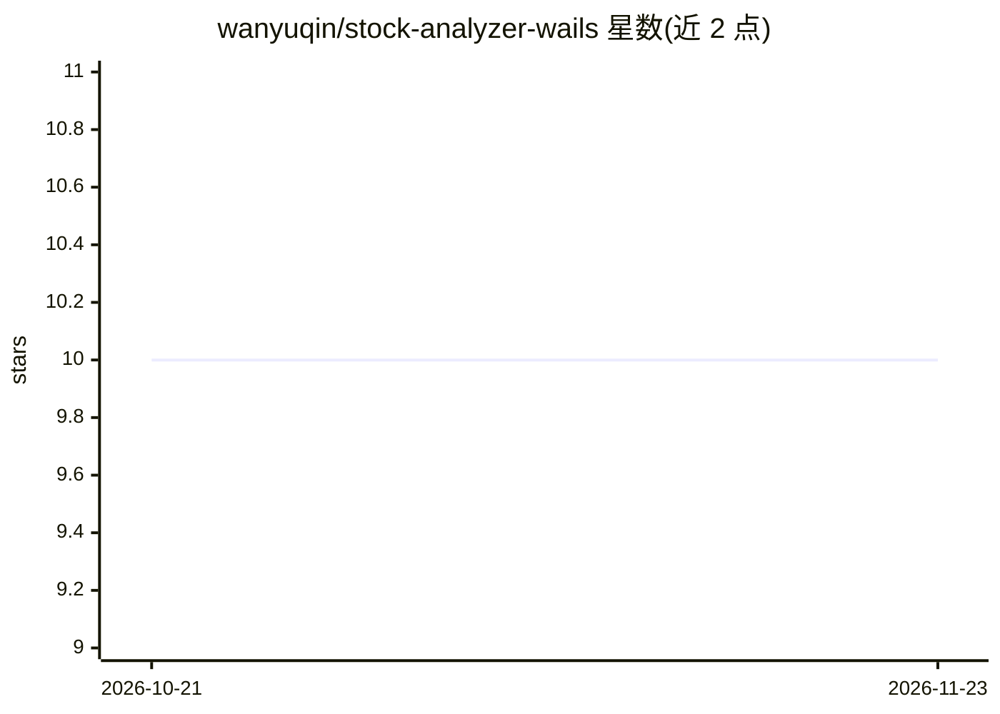

# wanyuqin/stock-analyzer-wails

⭐ 10 · Go · 推送 2026-02-08 · [GitHub](https://github.com/wanyuqin/stock-analyzer-wails) · 个人维护 · 中文 README

**给A股投资者用 AI 生成股票分析报告的桌面应用**

基于 Go 与 Wails v2 的 A 股分析桌面程序，跨 Windows/macOS/Linux。通过东方财富公开 API 获取实时行情，使用 CloudWeGo Eino 框架经 qwen 适配器接入阿里百炼（DashScope）调用通义千问模型，生成包含基本面分析、技术面解读、投资建议与风险评估的报告。前端为 React + TypeScript。配置支持 config.yaml 或环境变量回退；日志使用 zap 并滚动写入文件。需自行申请 DashScope API Key，README 声明仅供学习研究。

## 筛选速览

| 维度 | 判定 | 备注 |
|---|---|---|
| AI 角色 | `ai-native` | 本体是模型或模型工具 |
| 许可风险 | `none` | — |
| 部署形态 | `library` | 以包/库形式分发 |
| 模型依赖 | — | README 未给出锁定关系 |
| 硬件要求 | — | 无带数字的原话,不猜 |
| 安装摩擦 | `low` | 无编译、无系统依赖或容器化 |
| 成熟度 | — | 结构信号不足 |

## 能力要点

- 东方财富 API 实时获取 A 股行情数据
- Eino 框架编排 + DashScope 通义千问生成分析报告
- config.yaml 优先、环境变量回退的双通道配置
- wails build 支持跨平台构建

## 适用场景

- 输入 A 股代码获取基本面与技术面分析报告
- 学习 Go + Wails + Eino 的 AI 应用开发实践

## 场景标签

`金融量化` · 领域:学习与行业

## 证据(README 行号)

> L3: 基于Go + Wails框架的A股股票分析桌面应用程序，通过东方财富API获取实时股票数据，结合 **CloudWeGo Eino** 框架和 **阿里百炼 (DashScope)** 进行智能分析，生成专业的投资建议报告。
> L8: - **AI智能分析**：集成 **Eino** 框架和 **阿里百炼 (DashScope)** 进行智能股票分析
> L158: 3. **点击分析**：系统将自动获取股票数据并进行AI分析

## 星数曲线

2026-10-21 10 → 2026-11-23 10（+0）

---
*卡片 v1 · prompt 1.4 · 生成 2026-11-19 · 置信度 high · 依据 README sha `b8c59045bdc9` · [字段定义](../../DATASET.md)*
