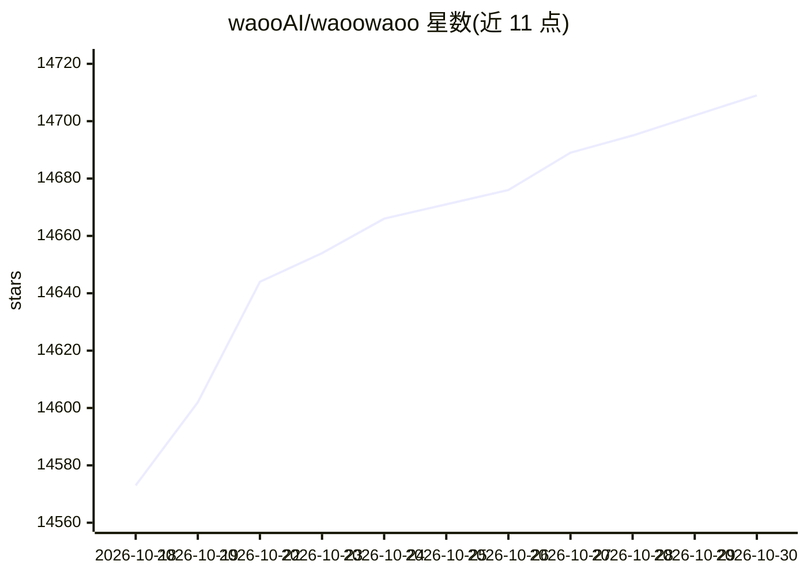

# waooAI/waoowaoo

⭐ 14,709 · TypeScript · NOASSERTION · 推送 2026-09-21 · [GitHub](https://github.com/waooAI/waoowaoo) · 组织维护 · 中文 README

**给创作者的可控 AI 影像生产画布工作区**

自托管的图像与视频创作工作区：右侧 Assistant 协助开发创意简报并生成资产，画布上上传参考素材、整理文件并检查生成结果。支持首帧、首尾帧、参考图等生成模式（可用性随所选模型而定），可对既有结果迭代新版本并保留原版。预览版通过 OpenRouter 接入模型（GPT Image 2、Nano Banana、Seedance、MiniMax H3 系列），调用费用由用户自己的 OpenRouter 账户承担；预览版不含音乐与配音控制。推荐以预构建 Docker 镜像分发部署。

## 筛选速览

| 维度 | 判定 | 备注 |
|---|---|---|
| AI 角色 | `ai-native` | 本体是模型或模型工具 |
| 许可风险 | `none` | NOASSERTION |
| 部署形态 | `None` |  |
| 模型依赖 | locked-api |  |
| 硬件要求 | — | 无带数字的原话,不猜 |
| 安装摩擦 | `medium` | 含编译或系统依赖之一 |
| 成熟度 | `idea` | |

## 动量与使用信号

- 维护:`active` — 距上次 push 26.9 天,年发版 4,1 位贡献者
- 涨星:近 1 天 **+9**(自 20261016 起算)
- 平台:WINDOWS · 协议:—

## 能力要点

- 画布式工作区：上传参考、整理文件、检视生成的图像与视频
- 模型感知的宽高比、时长、分辨率与参考角色配置
- 首帧/首尾帧/参考图生成模式，结果可迭代出新版本并保留原件
- 提供编码助手自动安装脚本与预构建 Docker 镜像两种部署路径

## 适用场景

- 从简报到成片素材，在画布上管理 AI 图像与视频生成流程
- 用参考图或首尾帧控制生成结果的可控视频创作
- 本地自托管部署一个私有媒体存储的 AI 创作环境

## 场景标签

`视频生成` `图像生成` · 领域:内容生成

## 证据(README 行号)

> L5:  An AI creative workspace for images and videos: develop ideas with the right-hand Assistant, upload references, and
> L22: This preview exposes **OpenRouter** configuration. Available models include GPT Image 2, Nano Banana variants, Seed
> L43: After launching, open your profile’s **API configuration** and add your OpenRouter API key. Provider calls are paid

## 星数曲线

2026-10-18 14,573 → 2026-10-30 14,709（+136）

---
*卡片 v1 · prompt 1.4 · 生成 2026-10-18 · 置信度 high · 依据 README sha `3338314217fc` · [字段定义](../../DATASET.md)*
