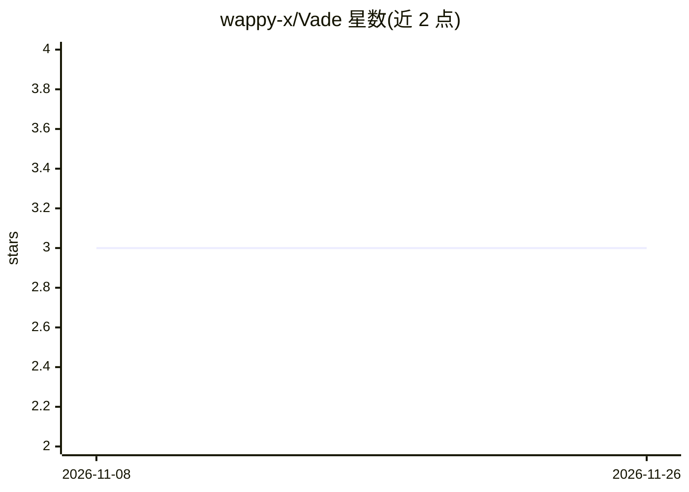

# wappy-x/Vade

⭐ 3 · Rust · Apache-2.0 · 推送 2026-11-25 · [GitHub](https://github.com/wappy-x/Vade) · [官网](https://vade.lol) · 组织维护

**为 NVIDIA DGX Spark 提供确定性本地 LLM 推理的 Rust 引擎**

Vade 是面向 NVIDIA DGX Spark（GB10）的推理引擎，用 Rust 从 GPU kernel 写起，零第三方 crate，kernel 编译为 PTX。核心机制是确定性：同一请求同一设置在每次运行、不同 Spark 数量下产生相同 token ID，并提供 vade verify 自验。支持 FP4 与 FP8 两种格式，可经 RDMA 链接 1–4 台 Spark 分摊推理。通过 shell 脚本一条命令安装，运行时仅需 NVIDIA 驱动。限制：仅支持 Qwen3.8 Flash-Next 系列模型，仅 Linux aarch64，需 CUDA 13.0+ 驱动与 112 GB 磁盘。

## 筛选速览

| 维度 | 判定 | 备注 |
|---|---|---|
| AI 角色 | `ai-ecosystem` | LLM/agent 周边工具 |
| 许可风险 | `permissive` | Apache-2.0 |
| 部署形态 | `None` |  |
| 模型依赖 | — | README 未给出锁定关系 |
| 硬件要求 | — | 无带数字的原话,不猜 |
| 安装摩擦 | `medium` | 含编译或系统依赖之一 |
| 成熟度 | — | 结构信号不足 |

## 能力要点

- 确定性输出：同请求同设置给出相同 token ID，附 vade verify 验证命令
- 纯 Rust 实现，零第三方 crate，kernel 编译为 PTX
- OpenAI 兼容 API（端口 18080）与内置终端编码代理 vade chat
- 1–4 台 Spark 经 RDMA 互联提升速度，支持 FP4/FP8 与投机解码

## 适用场景

- 在 DGX Spark 上本地运行 Qwen3.8 模型做 LLM 推理
- 需要可复现、确定性回答的推理场景
- 用 OpenAI 兼容客户端或 Claude Code/Codex 等编码工具接入本地引擎
- 链接多台 Spark 获得更快的单次对话或并发吞吐

## 场景标签

`推理引擎` · 领域:训练与推理

## 证据(README 行号)

> L5: Vade is an inference engine for the NVIDIA DGX Spark. It is written in Rust from the GPU kernels up, and it has zero
> L17: Then get the model with `vade pull nvidia/Qwen3.8-Flash-Next-FP4-Local@b9ce18a6887e18c089fdea8509a33e63429a3300` an
> L127: - **Hardware.** DGX Spark (NVIDIA GB10) on Linux `aarch64`.

## 星数曲线

2026-11-08 3 → 2026-11-26 3（+0）

---
*卡片 v1 · prompt 1.4 · 生成 2026-11-21 · 置信度 high · 依据 README sha `476d3f37b7a4` · [字段定义](../../DATASET.md)*
