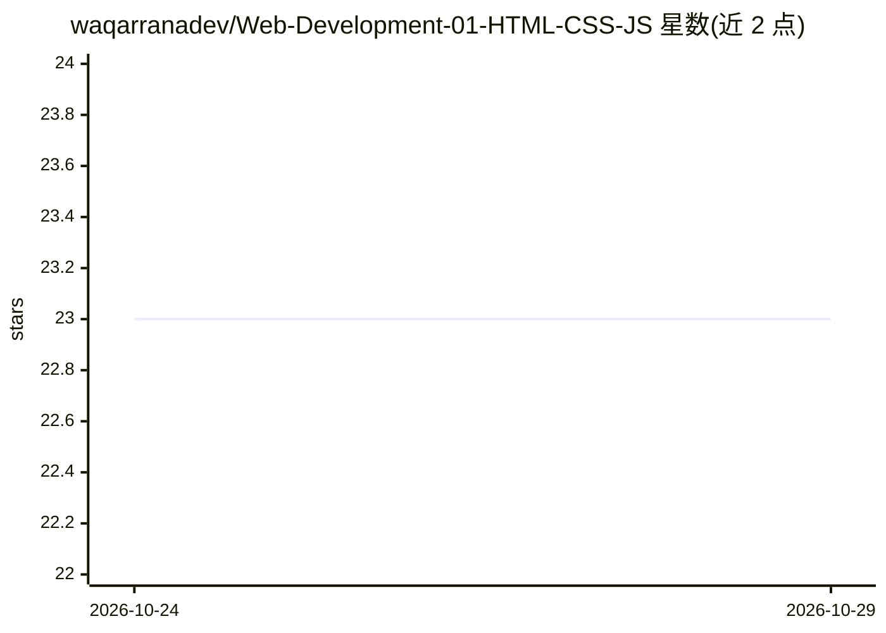

# waqarranadev/Web-Development-01-HTML-CSS-JS

⭐ 23 · 推送 2025-11-28 · [GitHub](https://github.com/waqarranadev/Web-Development-01-HTML-CSS-JS) · 个人维护

**面向学生的 AI 辅助 Web 开发入门课程资料仓库**

由讲师 Waqar Rana 组织的课程教学材料仓库：以 12 周大纲讲授 HTML、CSS、JavaScript 基础（响应式布局、DOM、异步、数据结构等），并在教学流程中引入 ChatGPT、Google Gemini、GitHub Copilot 等 AI 工具做代码生成、调试与提示词工程练习。含学习成果清单、期末项目要求（部署到 GitHub Pages 或 Netlify）、评分标准与学生提交作业的贡献指引（Fork/分支/PR）。仓库本体是课程文档，不含可运行的软件产品。

## 筛选速览

| 维度 | 判定 | 备注 |
|---|---|---|
| AI 角色 | `ai-knowledge` | 知识聚合/清单类 |
| 许可风险 | `none` | — |
| 部署形态 | `None` |  |
| 模型依赖 | — | README 未给出锁定关系 |
| 硬件要求 | — | 无带数字的原话,不猜 |
| 安装摩擦 | `low` | 无编译、无系统依赖或容器化 |
| 成熟度 | — | 结构信号不足 |

## 能力要点

- 12 周课程大纲覆盖 HTML/CSS/JS 基础到异步 JavaScript
- 将 ChatGPT、Gemini、Copilot 纳入教学与练习流程
- 期末项目要求含部署到 GitHub Pages 或 Netlify
- 提供学生作业提交的 Fork/分支/PR 流程指引

## 适用场景

- 跟着周计划从零学习前端三件套
- 在课程框架内练习用 AI 工具辅助写代码和提示词
- 作为教学大纲与评分标准模板参考

## 场景标签

`教程课程` · 领域:学习与行业

## 证据(README 行号)

> L9: This repository contains all course materials, weekly topics, and resources for the **AI-Powered Web Development** c
> L34: ## 🧭 Course Outline

## 星数曲线

2026-10-24 23 → 2026-10-29 23（+0）

---
*卡片 v1 · prompt 1.4 · 生成 2026-10-27 · 置信度 high · 依据 README sha `1f5b9004fc06` · [字段定义](../../DATASET.md)*
