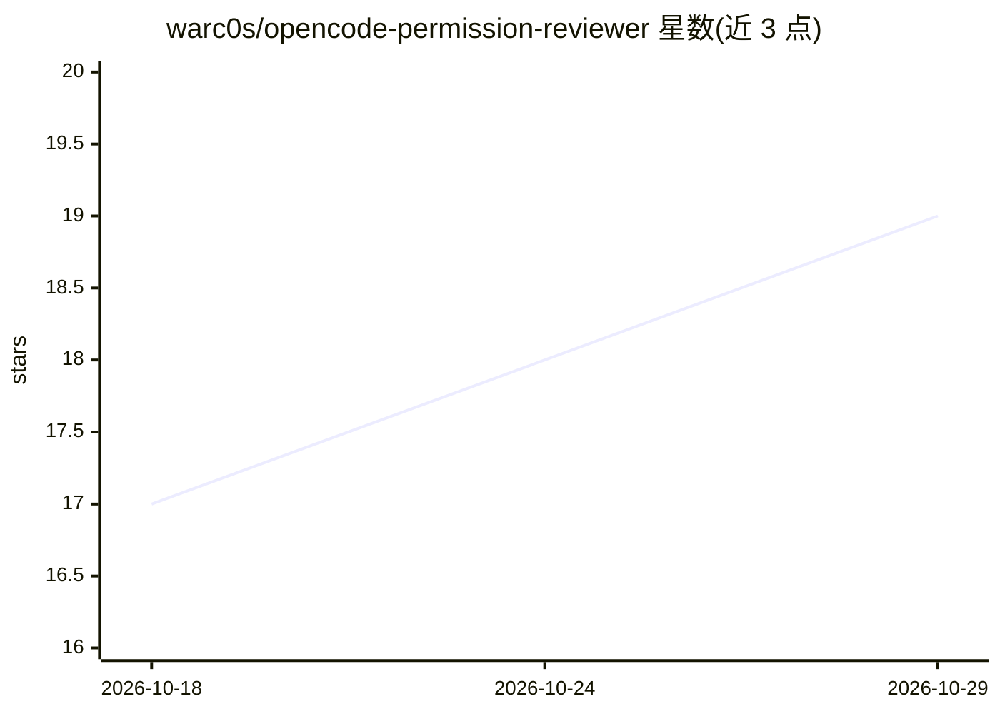

# warc0s/opencode-permission-reviewer

⭐ 19 · TypeScript · Apache-2.0 · 推送 2026-10-27 · [GitHub](https://github.com/warc0s/opencode-permission-reviewer) · 个人维护

**OpenCode 权限请求的 AI 审查插件：自动放行/拒绝/上报**

面向 OpenCode V1/V2 的非官方社区插件，拦截每个 `ask` 权限请求：由一个禁用全部工具的隔离模型读取待审请求、限界证据与租户策略，输出 allow、deny（附反馈）或升级给用户。默认审查模型为 openai/gpt-6-luna，可换用任意已配置的 provider/model，或通过 Jev System One API 直连（支持 Liquid AI、Baseten 等决策模型）。每次审查产出一条 JSONL 审计记录，远程命令以 SHA-256 存储。可选 TUI 覆盖层展示审查状态。需 Bun ≥1.3.0、OpenCode 与至少一条 `ask` 策略规则方可生效；OpenCode Zen 免费模型不可用作审查器。

## 筛选速览

| 维度 | 判定 | 备注 |
|---|---|---|
| AI 角色 | `ai-ecosystem` | LLM/agent 周边工具 |
| 许可风险 | `permissive` | Apache-2.0 |
| 部署形态 | `library` | 以包/库形式分发 |
| 模型依赖 | — | README 未给出锁定关系 |
| 硬件要求 | — | 无带数字的原话,不猜 |
| 安装摩擦 | `low` | 无编译、无系统依赖或容器化 |
| 成熟度 | — | 结构信号不足 |

## 能力要点

- 审查模型运行在全部工具被禁用的隔离会话中
- 每次审查输出一条 JSONL 审计记录，远程命令以 SHA-256 存储
- 支持任意已配置 provider/model，或 Jev System One 直连（Liquid AI/Baseten 等路由）
- 提供 CLI 安装器与可选 TUI 覆盖层

## 适用场景

- 让 OpenCode 的安全 `ask` 请求自动通过，减少按键等待
- 对高风险命令保留阻断或人工确认，失败不产生新批准
- 为团队 AI 编码代理实施统一的权限策略审查

## 场景标签

`网络安全` · 领域:学习与行业

## 证据(README 行号)

> L7: > **A tool-free AI reviewer for every `ask` permission.** It reads the request,
> L21: for safe, routine actions. This plugin adds a Codex-Guardian-style reviewer: a

## 星数曲线

2026-10-18 17 → 2026-10-29 19（+2）

---
*卡片 v1 · prompt 1.4 · 生成 2026-10-28 · 置信度 high · 依据 README sha `0d704df286bd` · [字段定义](../../DATASET.md)*
