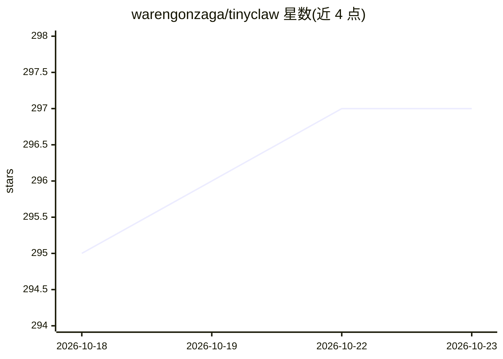

# warengonzaga/tinyclaw

⭐ 297 · TypeScript · GPL-3.0 · 推送 2026-10-13 · [GitHub](https://github.com/warengonzaga/tinyclaw) · [官网](https://tinyclaw.ai) · 个人维护

**个人自主 AI 伴侣框架，微小核心+插件架构**

从零构建的个人 AI 伴侣应用与框架，采用微小核心设计，通道、提供商与工具均以插件形式存在。内置基于 SQLite 的三层记忆系统（情景记忆、语义 FTS5、时间衰减）、8 维查询分类的智能路由、4 层上下文压缩管线、SHIELD.md 反恶意软件执行引擎与子代理委派系统。默认使用 Ollama Cloud 的 kimi-k2.5:cloud 与 gpt-oss:120b-cloud 两个内置模型，支持 OpenAI/Anthropic 等多提供商自动故障转移。基于 Bun 运行时，自带 Discord 风格 Web 界面；项目处于重度开发阶段，官方建议等待首个正式发布。

## 筛选速览

| 维度 | 判定 | 备注 |
|---|---|---|
| AI 角色 | `ai-native` | 本体是模型或模型工具 |
| 许可风险 | `viral` | GPL-3.0 |
| 部署形态 | `None` |  |
| 模型依赖 | local-ok | 支持本地模型 |
| 硬件要求 | — | 无带数字的原话,不猜 |
| 安装摩擦 | `low` | 无编译、无系统依赖或容器化 |
| 成熟度 | `idea` | |

## 能力要点

- 微小核心+插件架构（通道/提供商/工具均为插件）
- 三层记忆系统与 4 层上下文压缩管线
- 8 维查询分类智能路由按层级分配模型以控制成本
- 内置 Ollama Cloud 提供商，多提供商自动故障转移

## 适用场景

- 作为个人 AI 伴侣协助日常工作与项目
- 通过对话完成自配置，无需手动编写配置文件
- 通过插件扩展通道、提供商与工具

## 场景标签

 · 领域:AI Agent/个人助手

## 证据(README 行号)

> L8: **Your autonomous AI companion.**
> L16: AI agents today are powerful but complex, expensive to run, and heavy to set up. Tiny Claw believes AI should be **
> L61: |💬|**Discord-Like UI**|Dark-themed web interface inspired by Discord with real-time SSE streaming, typing indicator

## 星数曲线

2026-10-18 295 → 2026-10-23 297（+2）

---
*卡片 v1 · prompt 1.4 · 生成 2026-10-21 · 置信度 high · 依据 README sha `a91ccef7a086` · [字段定义](../../DATASET.md)*
