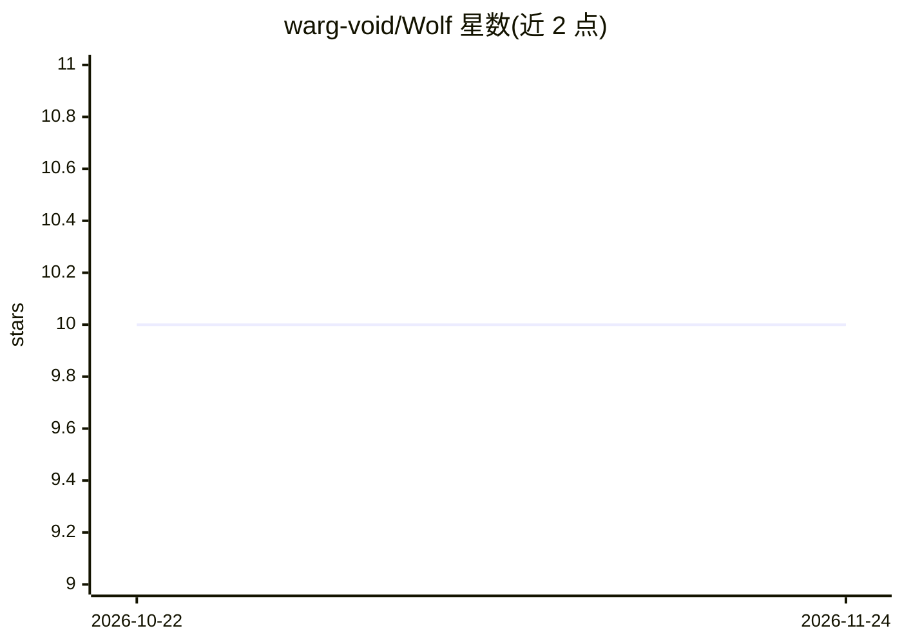

# warg-void/Wolf

⭐ 10 · C++ · 推送 2025-12-03 · [GitHub](https://github.com/warg-void/Wolf) · [官网](https://warg-void.github.io/wolf-docs/) · 个人维护

**CPU 上训练全连接网络的 C++23 神经网络库**

一个基础（barebones）的 C++23 神经网络实现，在 CPU 上训练全连接前馈网络。支持反向传播与 SGD、Linear/ReLU 层、批量学习，提供 Adam/Momentum/RMSProp 优化器与 MSE、交叉熵、二元交叉熵损失，并带保存/加载网络的辅助函数。通过 CMake 从源码构建，附 XOR、Iris、MNIST 三个示例，内建 OpenMP 并行与 zpp_bits 序列化，无需额外安装依赖。

## 筛选速览

| 维度 | 判定 | 备注 |
|---|---|---|
| AI 角色 | `ai-native` | 本体是模型或模型工具 |
| 许可风险 | `none` | — |
| 部署形态 | `None` |  |
| 模型依赖 | — | README 未给出锁定关系 |
| 硬件要求 | — | 无带数字的原话,不猜 |
| 安装摩擦 | `medium` | 含编译或系统依赖之一 |
| 成熟度 | — | 结构信号不足 |

## 能力要点

- 全连接前馈网络训练：反向传播 + SGD，支持批量学习
- 提供 Adam、Momentum、RMSProp 优化器与 MSE/交叉熵损失
- 网络保存/加载辅助函数（zpp_bits 序列化）
- CMake 源码构建，附 XOR/Iris/MNIST 示例

## 适用场景

- 在 CPU 上训练小型全连接网络
- 阅读 C++ 神经网络底层实现
- 运行 MNIST/Iris/XOR 示例学习训练流程

## 场景标签

`模型训练` · 领域:训练与推理

## 证据(README 行号)

> L3: Wolf is a barebones C++23 neural network implementation.
> L15: - Fully connected feed-forward neural networks

## 星数曲线

2026-10-22 10 → 2026-11-24 10（+0）

---
*卡片 v1 · prompt 1.4 · 生成 2026-11-19 · 置信度 high · 依据 README sha `14d6287ffa47` · [字段定义](../../DATASET.md)*
