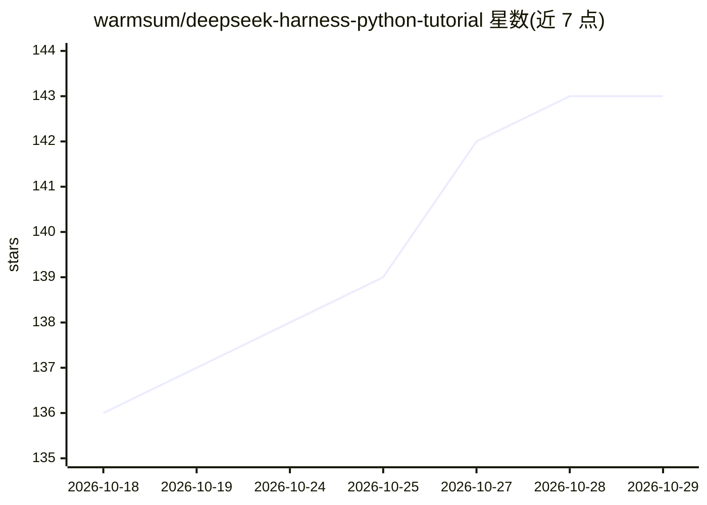

# warmsum/deepseek-harness-python-tutorial

⭐ 143 · Python · MIT · 推送 2026-09-10 · [GitHub](https://github.com/warmsum/deepseek-harness-python-tutorial) · 个人维护 · 中文 README

**用 Python 从零实现 DeepSeek Harness 核心机制的 17 章中文教程**

面向具备 Python 基础的开发者与自学者的教学项目：将 TypeScript 开发的 DeepSeek Harness（DSH）智能体运行系统拆解为 17 个 Python 章节，从流式模型调用、工具调用、插件系统、会话持久化、上下文压缩，到文件/命令能力、技能、子智能体与 headless CLI 组装，每章含问题背景、完整代码、真实输出、官方源码对照与练习。使用 uv 管理环境，需 Python 3.11+，联网章节需 DeepSeek API key 并产生真实用量。固定参考 DSH 预发布版 dsh-v0.1.5-alpha.2；教学版路径围栏运行于普通 Python 进程，不实现图形界面与云端隔离。

## 筛选速览

| 维度 | 判定 | 备注 |
|---|---|---|
| AI 角色 | `ai-knowledge` | 知识聚合/清单类 |
| 许可风险 | `permissive` | MIT |
| 部署形态 | `None` |  |
| 模型依赖 | — | README 未给出锁定关系 |
| 硬件要求 | — | 无带数字的原话,不猜 |
| 安装摩擦 | `low` | 无编译、无系统依赖或容器化 |
| 成熟度 | — | 结构信号不足 |

## 能力要点

- 17 章覆盖 Agent Loop、插件生命周期、会话持久化、上下文压缩、子智能体等机制
- 每章附官方 TypeScript 源码对照表，固定参考 DSH dsh-v0.1.5-alpha.2 版本
- 第 10/11 章文件与命令操作带路径围栏、审批与超时限制
- 最终组装出 headless 命令行智能体（JSON-RPC 走标准输入输出）

## 适用场景

- Python 开发者不读 TypeScript 源码也能理解 DSH 智能体运行机制
- 系统学习事件溯源、上下文工程、插件化等智能体内部实现
- 按 01/02/09/17 快速路径了解课程实现深度

## 场景标签

`教程课程` · 领域:学习与行业

## 证据(README 行号)

> L5:  用 Python 从一次模型调用开始，逐步构建 DeepSeek Harness 的核心运行机制
> L17: mini-harness 将 DSH 的核心机制拆成 17 个 Python 章节。课程从最小的流式模型调用开始，依次加入工具、会话、提示词、持久化、上下文压缩、文件与命令能力、技能、子智能体和网络搜索，最后组装出一个能够接收任务
> L32: 这套课程面向具备 Python 基础、希望理解智能体内部运行方式的开发者和自学者。开始学习前，只需要能够阅读函数、类、字典和异常处理，并了解通过 API 调用大语言模型的基本概念。课程不要求 TypeScript 经验，也不要求提

## 星数曲线

2026-10-18 136 → 2026-10-29 143（+7）

---
*卡片 v1 · prompt 1.4 · 生成 2026-10-22 · 置信度 high · 依据 README sha `3dec4426816a` · [字段定义](../../DATASET.md)*
