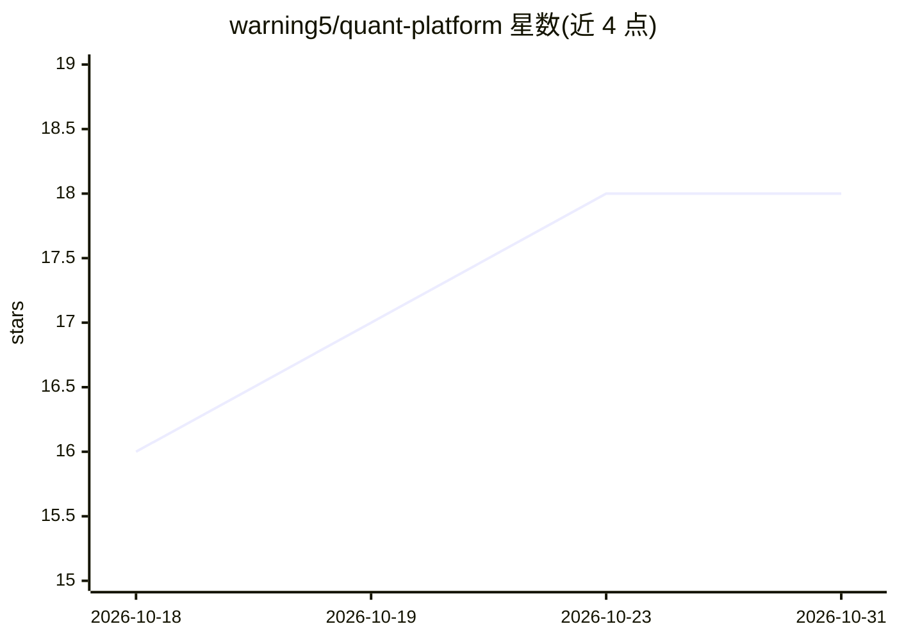

# warning5/quant-platform

⭐ 18 · Java · Apache-2.0 · 推送 2026-10-13 · [GitHub](https://github.com/warning5/quant-platform) · [官网](https://www.hwtx.site) · 个人维护 · 中文 README

**A 股量化投研一体化平台：因子挖掘、回测与 AI 分析**

基于 Spring Boot 3 + React 18 + ClickHouse/MySQL 的 A 股量化投研平台，覆盖 5000+ 股票，功能包括 35+ 内置因子的全生命周期管理（IC 分析、衰减检测、去冗余）、14 套策略、事件驱动回测（Brinson 归因、FF3、蒙特卡洛 VaR、Walk-Forward）、P1-P6 六阶每日选股推荐管线、组合风控与模拟交易。数据来自 Baostock/腾讯/AKShare/东方财富/同花顺 5 源采集。AI 部分为集成 DeepSeek 的个股分析：因子画像、财务诊断、风险预警。面向个人量化投资者、研究团队与金融科技公司，需自行编译部署并手动导入 61 张表结构。

## 筛选速览

| 维度 | 判定 | 备注 |
|---|---|---|
| AI 角色 | `ai-enhanced` | 去掉 AI 部分产品仍成立 |
| 许可风险 | `permissive` | Apache-2.0 |
| 部署形态 | `library` | 以包/库形式分发 |
| 模型依赖 | locked-api |  |
| 硬件要求 | — | 无带数字的原话,不猜 |
| 安装摩擦 | `low` | 无编译、无系统依赖或容器化 |
| 成熟度 | — | 结构信号不足 |

## 能力要点

- 35+ 因子全生命周期管理与 P1-P6 每日选股推荐管线
- 事件驱动回测含 Brinson 归因、FF3、蒙特卡洛 VaR/CVaR、Walk-Forward
- DeepSeek 驱动的个股因子画像与财务诊断
- 5 源行情采集 + ClickHouse 列存 + 定时任务依赖链编排

## 适用场景

- 个人量化投资者使用内置因子与回测引擎做 A 股策略研究
- 量化团队管理因子生命周期并监控因子衰减
- 每日自动获取选股推荐并在模拟盘验证
- 通过 AI 分析生成个股因子画像与财务诊断

## 场景标签

`金融量化` · 领域:学习与行业

## 证据(README 行号)

> L29: |**AI 分析**|DeepSeek 大模型驱动，个股因子画像、财务诊断、风险预警一键生成|
> L73: ### 🤖 AI 驱动分析 — DeepSeek 大模型加持

## 星数曲线

2026-10-18 16 → 2026-10-31 18（+2）

---
*卡片 v1 · prompt 1.4 · 生成 2026-10-29 · 置信度 high · 依据 README sha `a670cb6807ed` · [字段定义](../../DATASET.md)*
