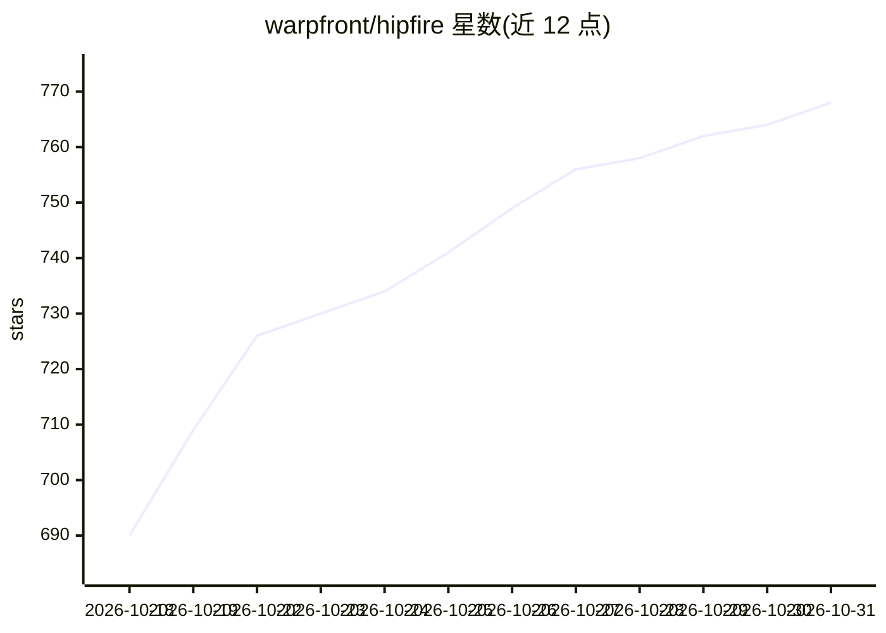

# warpfront/hipfire

⭐ 768 · Rust · NOASSERTION · 推送 2026-10-30 · [GitHub](https://github.com/warpfront/hipfire) · 组织维护

**面向 AMD GPU 的 Rust 本地 LLM 推理引擎**

用 Rust + HIP 实现的本地 LLM 推理引擎，优先适配 RDNA 架构并支持 CDNA，热路径不含 Python、PyTorch 或第三方推理引擎，ROCm 动态加载。自带模型注册表（90 个条目）、CLI（pull/run/chat/serve/bench/quantize）与 OpenAI 兼容 HTTP 守护进程，提供 MQ3–MQ6、MQ4R、MFP4 等自研量化格式、投机解码（DFlash/MTP）、多 GPU 专家并行、Redline 回放层与 PeaceMaker 自研内核工具链，另有 FLUX 图像生成支持。给希望在 AMD 显卡上本地运行 LLM 的开发者使用。

## 筛选速览

| 维度 | 判定 | 备注 |
|---|---|---|
| AI 角色 | `ai-ecosystem` | LLM/agent 周边工具 |
| 许可风险 | `none` | NOASSERTION |
| 部署形态 | `None` |  |
| 模型依赖 | — | README 未给出锁定关系 |
| 硬件要求 | — | 无带数字的原话,不猜 |
| 安装摩擦 | `medium` | 含编译或系统依赖之一 |
| 成熟度 | — | 结构信号不足 |

## 能力要点

- 自带 90 条目模型注册表与 OpenAI 兼容 API 守护进程
- 自研量化格式 MQ3–MQ6 / MQ4R / MFP4 与 quantize 命令
- 投机解码（DFlash 草稿模型、原生 MTP）与多 GPU 专家并行
- PeaceMaker 内核工具链直接构建 AMD GPU 与 XDNA2 NPU 程序

## 适用场景

- 在 RDNA/CDNA 显卡的机器上本地运行 Qwen 等模型并对话
- 通过 OpenAI 兼容 API 在本机服务模型
- 本地生成图像（FLUX）与量化自有模型

## 场景标签

`推理引擎` `模型量化` `图像生成` · 领域:内容生成

## 证据(README 行号)

> L23: hipfire is an inference engine for AMD GPUs. It ships its own Rust runtime,
> L29: You get a curated model registry, a CLI (`pull`, `run`, `chat`, `serve`,

## 星数曲线

2026-10-18 690 → 2026-10-31 768（+78）

---
*卡片 v1 · prompt 1.4 · 生成 2026-10-21 · 置信度 high · 依据 README sha `3be43543bf8b` · [字段定义](../../DATASET.md)*
