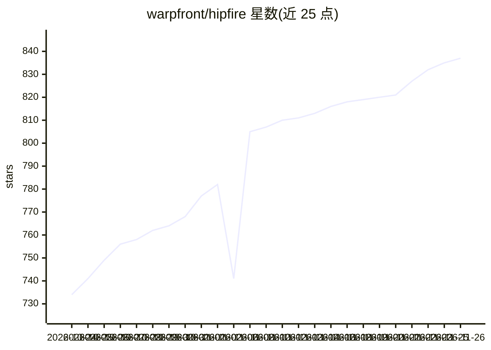

# warpfront/hipfire

⭐ 837 · Rust · NOASSERTION · 推送 2026-11-25 · [GitHub](https://github.com/warpfront/hipfire) · 组织维护

**面向 AMD GPU 的本地 LLM 推理引擎**

以 Rust 实现的 AMD GPU 本地 LLM 推理引擎，自带运行时、模型实现、量化格式（MQ3–MQ6 等）、HIP kernel，动态加载 ROCm，热路径中不含 Python/PyTorch/CUDA 翻译层。提供模型注册表、CLI（pull/run/chat/serve/bench/quantize）与 OpenAI 兼容 HTTP 服务（默认仅监听 loopback），支持推测解码、多 GPU 专家/张量并行、视觉塔流式加载与图像生成。面向拥有 AMD RDNA/CDNA 显卡的用户。

## 筛选速览

| 维度 | 判定 | 备注 |
|---|---|---|
| AI 角色 | `ai-ecosystem` | LLM/agent 周边工具 |
| 许可风险 | `none` | NOASSERTION |
| 部署形态 | `self-host` | docker 或自建部署 |
| 模型依赖 | — | README 未给出锁定关系 |
| 硬件要求 | — | 无带数字的原话,不猜 |
| 安装摩擦 | `low` | 无编译、无系统依赖或容器化 |
| 成熟度 | `idea` | |

## 能力要点

- 自带 Rust 运行时与 HIP kernel，动态加载 ROCm，无 Python 热路径
- OpenAI 兼容 HTTP daemon（127.0.0.1:11435）与 CLI 工具链
- 支持推测解码（DFlash/MTP）、多 GPU 专家与张量并行
- 支持 Flux Schnell 图像生成与 Qwen VL 视觉模型

## 适用场景

- 在 AMD 显卡上本地运行和对话大模型
- 为本地模型提供 OpenAI 兼容 API 服务
- 对 RDNA 卡做量化与推理基准测试

## 场景标签

`推理引擎` `模型量化` `图像生成` · 领域:内容生成

## 证据(README 行号)

> L5:  Local LLM inference for AMD GPUs. Tuned first for RDNA, with CDNA support.
> L24: hipfire is an inference engine for AMD GPUs. It ships its own Rust runtime,
> L30: You get a curated model registry, a CLI (`pull`, `run`, `chat`, `serve`,
> L31: `bench`, `quantize`) and an OpenAI-compatible HTTP daemon. Speculative

## 星数曲线

2026-10-24 734 → 2026-11-26 837（+103）

---
*卡片 v1 · prompt 1.4 · 生成 2026-11-26 · 置信度 high · 依据 README sha `3428110cae94` · [字段定义](../../DATASET.md)*
