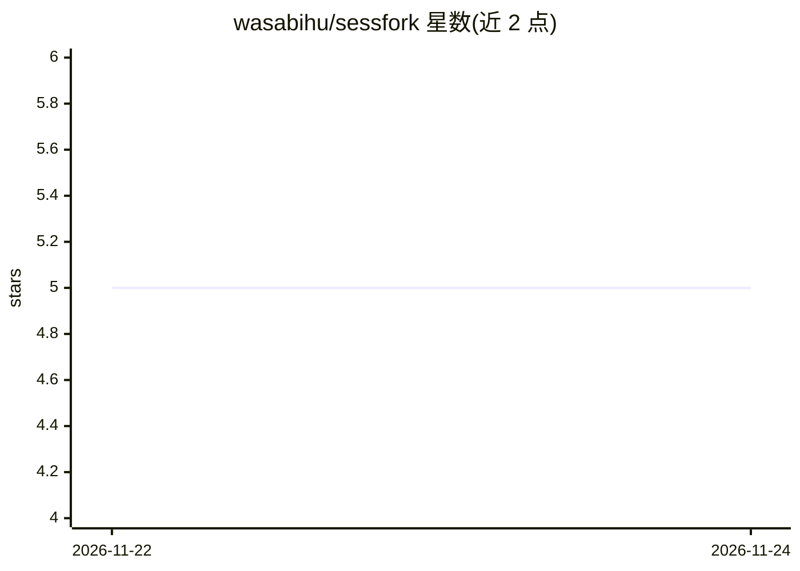

# wasabihu/sessfork

⭐ 8 · Python · MIT · 推送 2026-11-23 · [GitHub](https://github.com/wasabihu/sessfork) · [官网](https://wasabihu.github.io/sessfork/) · 个人维护

**把已登录的 Chrome 会话无头派生给 AI agent 浏览器**

以一条命令把正在运行的 Chromium 登录态（SQLite Cookies 与 LevelDB LocalStorage）快照为 Playwright storageState 文件，供无头 AI agent 浏览器复用，主浏览器窗口不受干扰。通过 OS 原生 API 在内存中解密 cookie，默认仅提取用户指定的域名白名单，文件以 0600 权限落盘；自动检测 Antigravity/Claude Code/Cursor 并注册 sessfork-browser MCP 服务器。纯 Python 标准库实现，零运行时依赖；macOS 完整支持，Linux 实验性，Windows 不支持。

## 筛选速览

| 维度 | 判定 | 备注 |
|---|---|---|
| AI 角色 | `ai-ecosystem` | LLM/agent 周边工具 |
| 许可风险 | `permissive` | MIT |
| 部署形态 | `None` |  |
| 模型依赖 | — | README 未给出锁定关系 |
| 硬件要求 | — | 无带数字的原话,不猜 |
| 安装摩擦 | `low` | 无编译、无系统依赖或容器化 |
| 成熟度 | — | 结构信号不足 |

## 能力要点

- 一条命令 fork Cookies + LocalStorage 双层登录态，输出标准 Playwright storageState
- 零运行时依赖：纯 Python 3.9+ 标准库，macOS Keychain 解密 + 内置 LevelDB 读取器
- 自动注册 sessfork-browser 无头 MCP 服务器到已装的 AI agent 工具
- 域名白名单最小权限提取，状态文件 0600，诊断输出脱敏

## 适用场景

- 让 AI agent 无头访问我已登录的 GitHub/Notion/Linear 而不抢占我的 Chrome 窗口
- SPA/JWT 应用以 --no-cookies 只派发 LocalStorage 令牌避免 Keychain 弹窗
- 为本地开发环境的已登录 dashboard 做无头自动化验证

## 场景标签

`浏览器自动化` · 领域:效率与自动化

## 证据(README 行号)

> L16: `sessfork` decouples **your UI viewport** from **browser auth state** in a single command: it takes lock-free snaps
> L117: - **One-Command Auto-Wiring**: `sessfork <domain>` and `sessfork --setup` auto-detect Antigravity, Claude Code, an

## 星数曲线

2026-11-22 5 → 2026-11-24 5（+0）

---
*卡片 v1 · prompt 1.4 · 生成 2026-11-22 · 置信度 high · 依据 README sha `61cd3b823290` · [字段定义](../../DATASET.md)*
