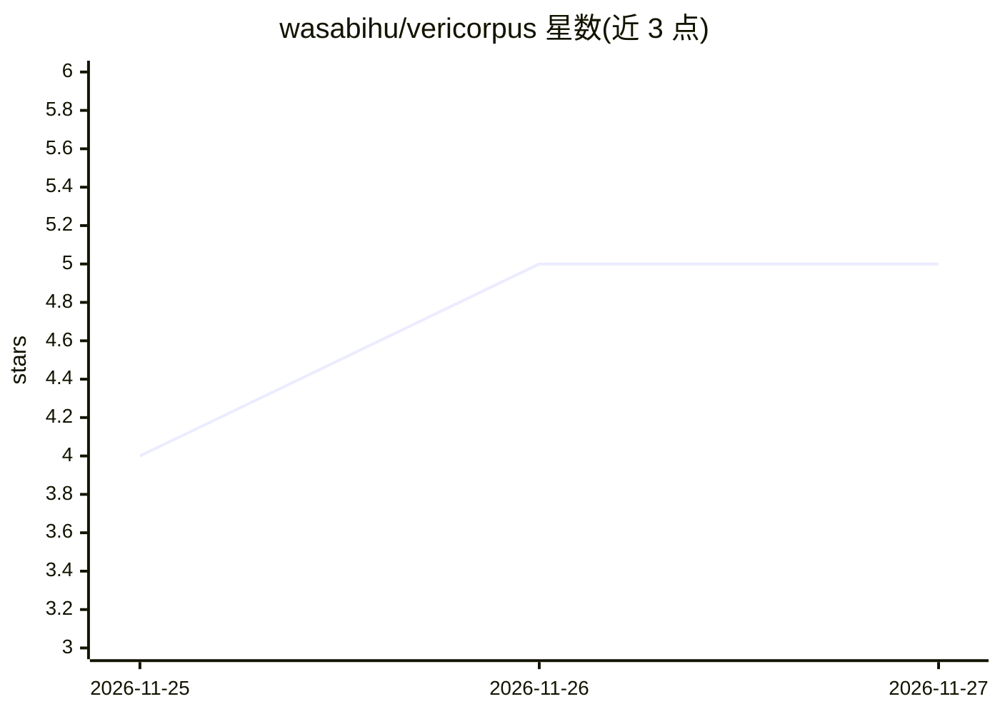

# wasabihu/vericorpus

⭐ 5 · Python · Apache-2.0 · 推送 2026-11-25 · [GitHub](https://github.com/wasabihu/vericorpus) · 个人维护 · 中文 README

**面向 XERJ/Elasticsearch 引擎的合规多语种语料包与中英双语检索评测基准**

VeriCorpus 提供经许可证审查的金融（SEC/港交所）、法规与临床试验表格语料目录（8 个 pack + 3 个 recipe），并配套 PDF 表格几何重建管线、HKEX CMap 修复器、简繁/数字/会计口径互通的双语查询适配器，以及零泄漏端到端 RAG 评测套件（含 Ed25519 签名校验）。核心控制面 100% Python 标准库零第三方依赖；PDF 坐标重建需按需安装 PyMuPDF 扩展。适用于构建与检验检索/RAG 系统的工程与研究人员。

## 筛选速览

| 维度 | 判定 | 备注 |
|---|---|---|
| AI 角色 | `ai-knowledge` | 知识聚合/清单类 |
| 许可风险 | `permissive` | Apache-2.0 |
| 部署形态 | `library` | 以包/库形式分发 |
| 模型依赖 | — | README 未给出锁定关系 |
| 硬件要求 | — | 无带数字的原话,不猜 |
| 安装摩擦 | `low` | 无编译、无系统依赖或容器化 |
| 成熟度 | — | 结构信号不足 |

## 能力要点

- 11 个许可证严审语料目录：中国法规、SEC 财报/招股书、临床试验表、开放获取论文
- 纯标准库双语查询适配器：简繁互通、中文数字映射、会计口径对齐、0 命中拒答
- 可选 PyMuPDF 几何级 PDF 表格重建与 HKEX CMap 错字修复
- 60 题零泄漏端到端 RAG 基准与分离式 SHA256/Ed25519 签名套件

## 适用场景

- 为金融/法规/临床语料上的检索引擎构建可溯源评测基准
- 修复港交所 PDF 表格折行丢小数点与日期 CMap 错字问题
- 为中文查询补充简繁转换与法条/期号归一化检索能力

## 场景标签

`模型评测` · 领域:评测与运维

## 证据(README 行号)

> L13: **VeriCorpus** 是面向 XERJ 及 Elasticsearch 兼容检索引擎构建的**许可证严审语料工具包、可选坐标级 PDF 表格重建管线与零泄漏中英双语检索评测基准**（`Apache-2.0`）。核心控制面与
> L29: 4. **多基准隔离实弹评测与分离签名套件（`eval_hub.py` + `eval_primary_weekly.py` + `eval_e2e_rag.py` + `scripts/build_hubpacks.py`）**
> L42: |`ai-papers-ccby`|前沿 AI 论文 (`AI`)|`CC-BY-4.0`（OpenAlex + arXiv/EPMC 实核）|`pack`|50 篇 2022–2026 年高影响力开放获取 AI 论文（覆盖 RA

## 星数曲线

2026-11-25 4 → 2026-11-27 5（+1）

---
*卡片 v1 · prompt 1.4 · 生成 2026-11-24 · 置信度 high · 依据 README sha `b3de9f994f93` · [字段定义](../../DATASET.md)*
