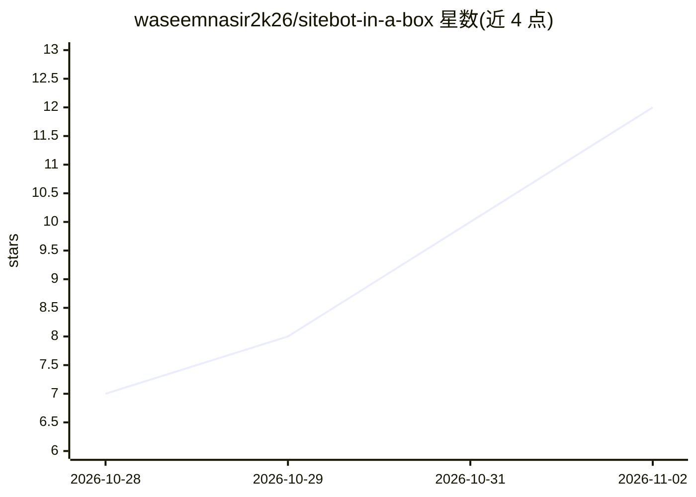

# waseemnasir2k26/sitebot-in-a-box

⭐ 12 · Python · MIT · 推送 2026-10-26 · [GitHub](https://github.com/waseemnasir2k26/sitebot-in-a-box) · [官网](https://skynetjoe.com) · 个人维护

**指向任一网站即生成只依据该站内容的带来源聊天组件**

自托管的网站问答聊天组件：本地爬取目标网站、生成嵌入并构建检索，组件只依据站内页面回答，附来源链接，站内无答案时明确拒绝。回答分为 full/partial/correction/soft miss/refuse 五类，由基于必需词、意图词与单句覆盖的规则层决定；模型只负责措辞单句完整答案，partial 答案直接引用页面原句。默认离线 mock（哈希嵌入、无 key），可选 Groq/Gemini/Ollama 措辞，支持 fastembed 的 bge-small 嵌入，附评测集结果。

## 筛选速览

| 维度 | 判定 | 备注 |
|---|---|---|
| AI 角色 | `ai-native` | 本体是模型或模型工具 |
| 许可风险 | `permissive` | MIT |
| 部署形态 | `self-host` | docker 或自建部署 |
| 模型依赖 | local-ok | 支持本地模型 |
| 硬件要求 | — | 无带数字的原话,不猜 |
| 安装摩擦 | `low` | 无编译、无系统依赖或容器化 |
| 成熟度 | — | 结构信号不足 |

## 能力要点

- 五类回答规则层：full/partial/correction/soft miss/refuse
- partial 答案引用页面原句，不将问题发给模型
- 默认离线 mock 路径：内置哈希嵌入，无需 key 与下载
- 拒绝拼接式回答：组合声明集要求 0 个 full 答案

## 适用场景

- 给潜在客户演示基于其自身网站内容的聊天机器人
- 为自有网站部署只回答站内内容并附来源的问答组件
- 在离线无 key 环境下快速跑通整条管线 demo

## 场景标签

 · 领域:RAG/网站聊天机器人

## 证据(README 行号)

> L10: **The prospect says "show me a chatbot on my content" and your demo is a generic bot that makes things up. This cra
> L49: **The keyless mock is a demo.** It picks the best matching sentences from the pages, so its wording is plain. With 

## 星数曲线

2026-10-28 7 → 2026-11-02 12（+5）

---
*卡片 v1 · prompt 1.4 · 生成 2026-11-02 · 置信度 mid · 依据 README sha `e358353f751f` · [字段定义](../../DATASET.md)*
